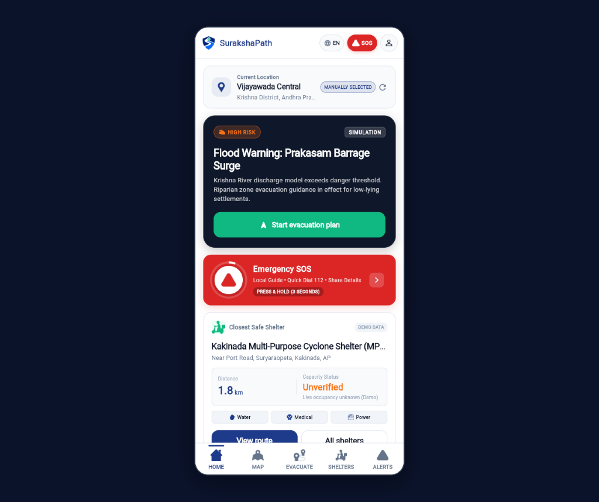
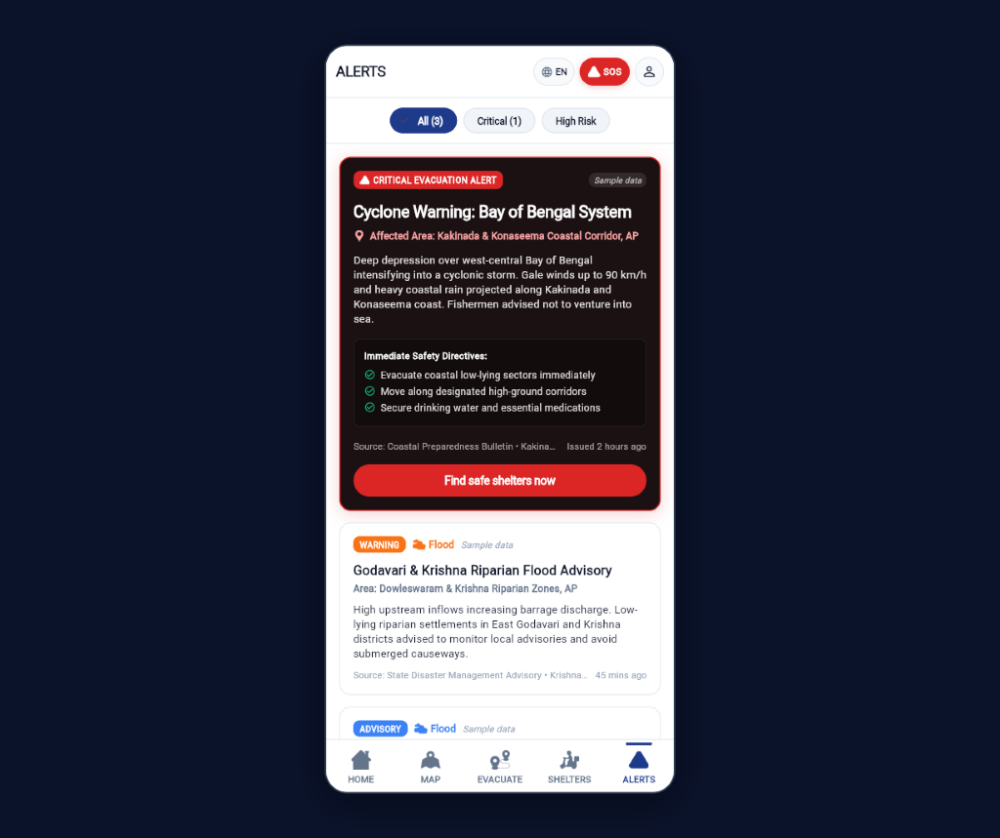
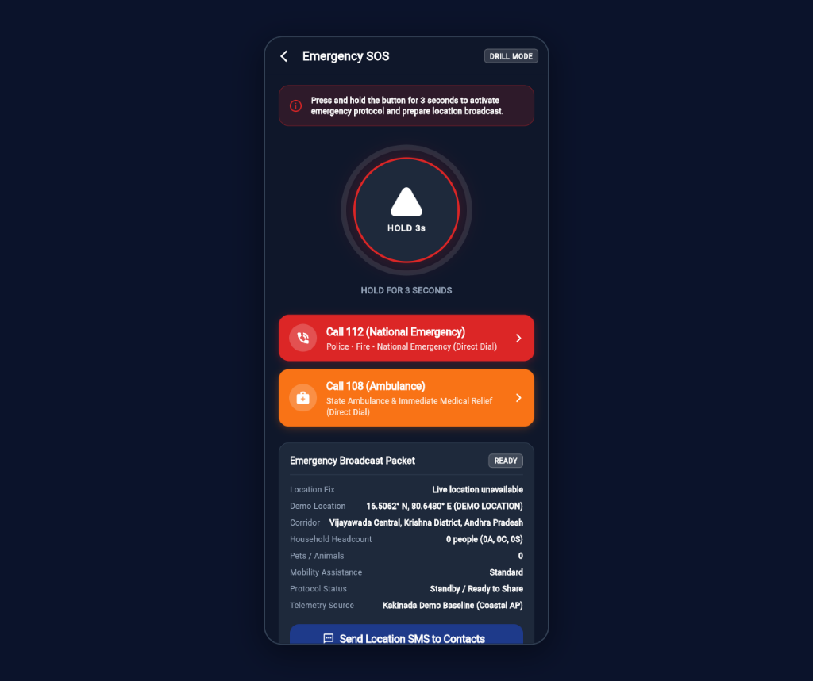
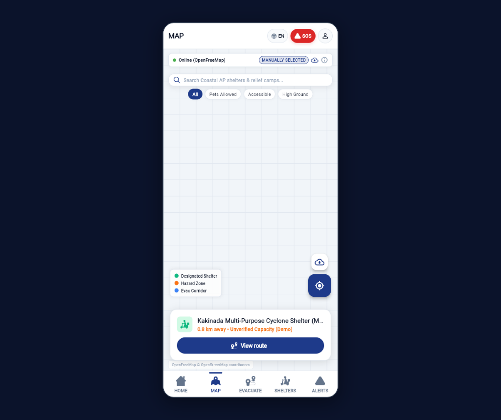
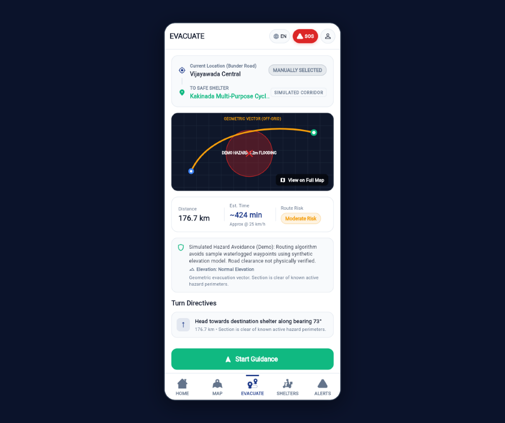
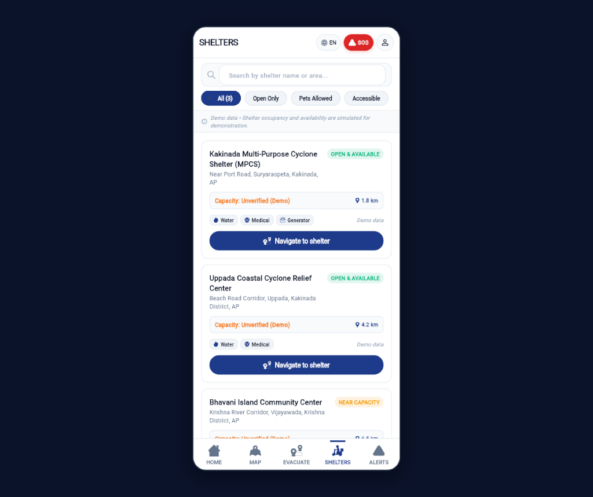
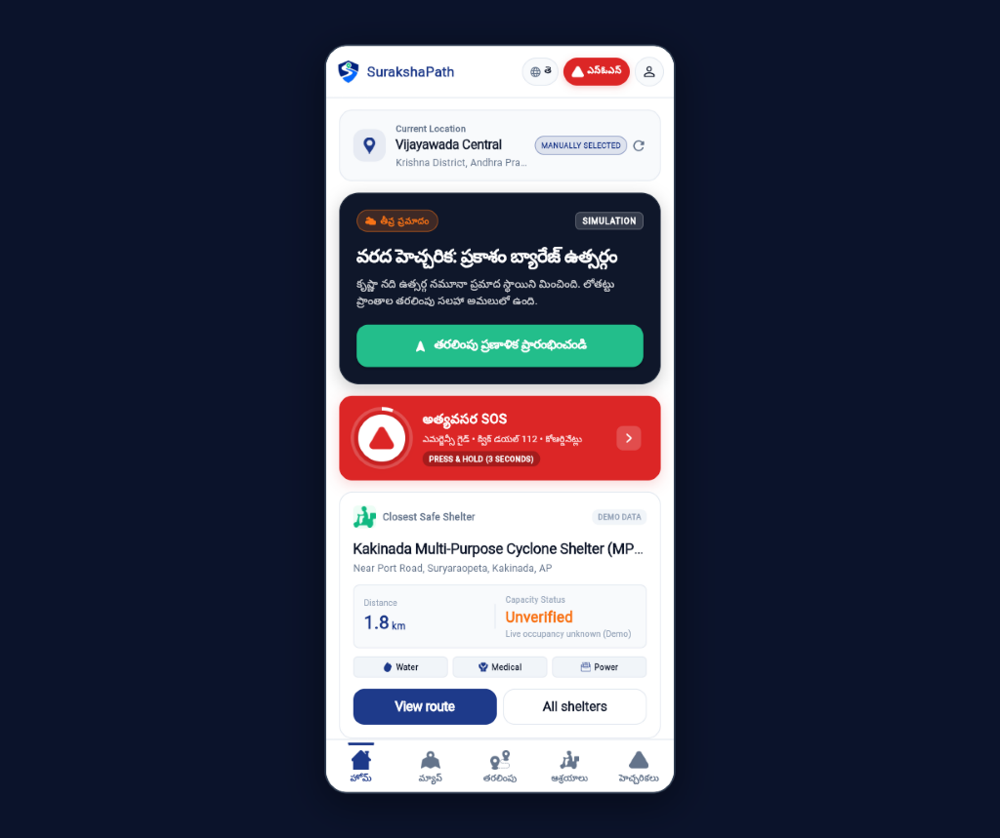

<p align="center">
  
</p>

<h1 align="center">SurakshaPath</h1>

<p align="center">
  <strong>సురక్షాపథం</strong> — <em>Navigate to Safety: Offline-First Disaster Evacuation, Hazard Avoidance & Relief Assistance Platform for Coastal Communities.</em>
</p>

<p align="center">
  <a href="https://flutter.dev"></a>
  <a href="https://dart.dev"></a>
  <a href="test/"></a>
  <a href="#"></a>
  <a href="https://maplibre.org"></a>
  <a href="#"></a>
</p>

---

## 1. Project Overview

**SurakshaPath** ("సురక్షాపథం" — *Path of Safety*) is an offline-first disaster preparedness, real-time emergency routing, and relief shelter assistance platform designed specifically for cyclone, storm-surge, and riparian flood emergencies across coastal corridors in **Andhra Pradesh, India**.

During extreme hydrological events (such as Bay of Bengal cyclonic storms and Krishna/Godavari river basin discharge surges), critical communications infrastructure, electrical grids, and commercial internet access frequently collapse. Citizens and emergency response volunteers are left without reliable navigation tools precisely when local roads, underpasses, and causeways submerge.

SurakshaPath bridges this critical gap by providing a resilient, low-cognitive-load mobile platform that operates seamlessly in disconnected environments. It leverages on-device spatial graph search, offline vector and raster cartography, hardware GNSS acquisition, and pre-bundled civil defense datasets to route evacuees away from waterlogged peril and directly toward designated safe shelters.

---

## 2. Problem Statement

Coastal Andhra Pradesh regularly experiences severe cyclonic depressions, torrential precipitation, and riverine flooding. During these emergencies:
1. **Network Blackouts:** Cellular base stations lose backhaul connectivity and power, disabling conventional cloud-based navigation applications (e.g., Google Maps, Apple Maps).
2. **Dynamic Inundation Risks:** Standard navigation tools lack real-time hydrological awareness, frequently directing evacuees into submerged causeways, flooded underpasses, or active flash-surge channels (e.g., Prakasam Barrage, Bandar Canal).
3. **Information Chaos & Language Gaps:** Vital safety bulletins and shelter occupancy updates are fragmented, unverified, or unavailable in native regional languages (Telugu).
4. **Vulnerable Population Tracking:** Evacuation teams often lack immediate insight into household headcounts, seniors, infants, or persons requiring wheelchair mobility assistance during rapid distress evacuations.

---

## 3. Proposed Solution

SurakshaPath delivers a multi-tiered disaster navigation framework engineered for total resilience:
- **Offline-First Spatial Architecture:** Local SQLite storage and pre-bundled disaster assets enable full app functionality without internet connectivity.
- **Dynamic Hazard-Aware Routing:** An on-device spatial graph solver (Dijkstra shortest-path with obstacle penalty multipliers) dynamically routes evacuees around active hazard perimeters and waterlogged nodes.
- **Single-Action Emergency Protocols:** A 3-second hold Emergency SOS mechanism formats distress telemetry (GPS coordinates, household composition, mobility needs) for immediate transmission via SMS and direct voice dialers to National Emergency Helpline (112) and State Ambulance (108).
- **Culturally Grounded Multilingual Interface:** Native bilingual architecture providing full parity between English and Telugu, reducing cognitive friction during high-stress evacuations.
- **Transparent Data Honesty:** All simulation parameters, drill contexts, and unverified shelter records are explicitly labeled to avoid false assurances.

---

## 4. Key Features

| Feature | Description | Status |
|---|---|:---:|
| **Situation Hero Dashboard** | Live disaster context card displaying active surge alerts, risk level, and instantaneous one-touch evacuation guidance. | **Verified** |
| **Interactive Vector Mapping** | MapLibre Native cartography with OpenFreeMap Liberty styling, high-contrast dark overlays, and interactive hazard markers. | **Verified** |
| **Hazard Proximity & Avoidance** | Haversine proximity detection and buffer zone evaluation around flood surges, canal breaches, and gale obstructions. | **Verified** |
| **Safe Shelter Discovery** | Comprehensive directory of designated cyclone shelters with accessibility, pet-friendly filters, and capacity tracking. | **Verified** |
| **Emergency SOS Dispatch** | Single-touch SOS trigger preparing pre-formatted emergency dispatch packets and direct hotline dialing (112 / 108). | **Verified** |
| **Household Telemetry Tracker** | Configurable profile tracking adults, children, seniors, pets, and mobility requirements directly embedded into distress packets. | **Verified** |
| **Full Bilingual Localization** | Comprehensive English and Telugu support with persistent on-device language switching. | **Verified** |
| **Offline Vector Map Tile Store** | SQLite-backed tile store with Web Mercator quota guards (<= 3,000 tiles) to prevent storage exhaustion. | **Verified** |
| **Statewide Valhalla OSM Engine** | Regional OpenStreetMap extraction pipeline for multi-modal statewide routing across 26 districts of Andhra Pradesh. | **Architecture / Plan Accepted** |

---

## 5. Offline-Capable Mapping Concept & Data Strategy

SurakshaPath implements a deterministic offline mapping strategy engineered specifically for intermittent connectivity:

```
[Online Source] OpenFreeMap / OSM Vector Tiles
         │
         ▼
[Quota Guard] Max 3,000 tiles per extraction bounding box
         │
         ▼
[Local Cache] SQLite Tile Database (`offline_tiles.db`)
         │
         ▼
[MapLibre Native / CanvasKit] Low-latency on-device rendering
         │
         ▼ (When Network Drops)
[Fallback Data] Bundled GeoJSON & JSON (`sample_shelters.json`, `sample_alerts.json`)
```

### Operational vs. Planned Capabilities:
- **Implemented & Verified:**
  - MapLibre Native vector tile integration with OpenFreeMap Liberty styles.
  - SQLite database schema (`offline_tiles.db`) for caching vector and raster tiles.
  - Quota safety guard ensuring bounding-box downloads do not exceed 3,000 tiles.
  - 100% offline fallback to bundled civil defense datasets (`sample_shelters.json`, `sample_alerts.json`, `roads.json`).
  - Native hardware GNSS satellite acquisition via `geolocator` without requiring internet connectivity.
- **Planned for Native Releases:**
  - Automated background tile pack pre-fetching for user-selected district corridors on Android/iOS native mobile builds.
  - Valhalla native routing tile bundling for complete on-device turn-by-turn routing across Andhra Pradesh.

---

## 6. Technology Stack

- **Framework:** [Flutter](https://flutter.dev) (v3.3+)
- **Programming Language:** [Dart](https://dart.dev) (v3.3+)
- **Design System:** Material 3 with high-contrast emergency palette and custom vector navigation icons
- **Map & Spatial Engine:** [MapLibre Native](https://maplibre.org) (`maplibre: ^0.4.0`), [OpenFreeMap](https://openfreemap.org)
- **Local Persistence:** `sqflite` (SQLite), `shared_preferences`
- **Location & Sensors:** `geolocator: ^14.1.2`, hardware GNSS telemetry
- **Internationalization:** `flutter_localizations`, `intl`, ARB localization (`app_en.arb`, `app_te.arb`)
- **Emergency Dispatch:** `url_launcher: ^6.3.3` (telephony URIs: `tel:112`, `tel:108`, `tel:1070`)
- **Geospatial Pipeline (Backend):** Python 3.11, Osmium tool, Shapely, PyProj, GeoJSON, EPSG:7755 (India NSF LCC)

---

## 7. Dependencies & External APIs

### Direct Runtime Dependencies (`pubspec.yaml`):
| Package | Version | Purpose |
|---|---|---|
| `connectivity_plus` | `^6.1.5` | Dynamic network reachability and connection state detection |
| `geolocator` | `^14.1.2` | Hardware GNSS fix, accuracy telemetry, and permission handling |
| `intl` | `^0.20.3` | Internationalization formatting and locale management |
| `maplibre` | `^0.4.0` | High-performance native vector map rendering and tile caching |
| `path` & `path_provider` | `^1.9.0` / `^2.1.5` | File system path resolution for offline tile stores |
| `permission_handler` | `^11.4.0` | Runtime Android and iOS permission orchestration |
| `shared_preferences` | `^2.5.6` | Persistent key-value storage for user profile, language, and onboarding |
| `sqflite` | `^2.4.6` | Embedded relational database for offline vector map tile caching |
| `url_launcher` | `^6.3.3` | System URI launcher for direct emergency telephone calls (112, 108) |

### External Endpoints:
- **OpenFreeMap Liberty Style & Vector Tiles:** `https://tiles.openfreemap.org/styles/liberty`
- **OpenStreetMap Basemap:** Raster fallback tiles (`https://tile.openstreetmap.org/{z}/{x}/{y}.png`)
- **National Emergency Number:** `112` (Direct telephony dispatch)
- **State Emergency Helpline:** `108` (Direct medical ambulance dispatch)

---

## 8. Application Screenshots

| Home Dashboard (English) | Hazard Alerts Bulletin | Emergency SOS Protocol |
|:---:|:---:|:---:|
|  |  |  |
| *Prakasam Barrage surge alert & one-touch evacuation* | *Regional coastal cyclone and flood advisories* | *Drill mode 112/108 dialer & headcount payload* |

| Interactive Vector Map | Evacuation Guidance Route | Shelters Directory |
|:---:|:---:|:---:|
|  |  |  |
| *OpenFreeMap vector tiles with hazard perimeters* | *Dynamic Dijkstra route avoiding flood zone* | *Shelters with accessibility & pet filters* |

| Telugu Regional Localization |
|:---:|
|  |
| *100% culturally accurate Telugu disaster terminology* |

---

## 9. Project Architecture Overview

SurakshaPath employs a decoupled, modular service-oriented architecture centered on strict contracts and single-source-of-truth state management:

```
┌────────────────────────────────────────────────────────────────────────┐
│                        PRESENTATION LAYER                              │
│  MainNavigationShell (Persistent Bottom Nav: Home, Map, Evac, Shelters)│
│  AppHeader (Branding, Red SOS Pill, Profile Avatar, Language Selector) │
└────────────────────────────────────┬───────────────────────────────────┘
                                     │
┌────────────────────────────────────▼───────────────────────────────────┐
│                          FEATURE MODULES                               │
│  features/home        features/map        features/routing             │
│  features/shelters    features/emergency  features/disaster            │
└────────────────────────────────────┬───────────────────────────────────┘
                                     │
┌────────────────────────────────────▼───────────────────────────────────┐
│                     CORE CONTRACTS & REPOSITORIES                      │
│  ILocationService    IShelterService    IAlertService    IRouteService │
└────────────────────────────────────┬───────────────────────────────────┘
                                     │
┌────────────────────────────────────▼───────────────────────────────────┐
│                  DATA SOURCES & HARDWARE INTEGRATION                   │
│  • Hardware GNSS (Geolocator)         • SQLite Tile Cache (sqflite)    │
│  • Bundled JSON Assets                • Shared Preferences Store       │
│  • OpenFreeMap Tile Service           • Native Telephony Dialers       │
└────────────────────────────────────────────────────────────────────────┘
```

---

## 10. Project Directory Layout

```
surakshapath/
├── android/                   # Native Android configuration and build files
├── assets/                    # Project runtime assets
│   ├── data/                  # Bundled offline fallback datasets (shelters, alerts, roads)
│   ├── icons/                 # Custom disaster hazard icons
│   └── icons/flaticon/        # High-contrast navigation vector icons
├── backend/                   # Geospatial extraction & Valhalla routing engine specs
│   ├── geo_pipeline/          # Python extraction scripts, district boundaries, configs
│   └── routing/               # Docker configurations and Valhalla POC service
├── docs/                      # Architectural reports, audits, and design specifications
│   ├── geo_pipeline/          # Phase 1B and Phase 2A GIS extraction documentation
│   ├── integration/           # Member integration reports and polish audits
│   └── screenshots/           # Demonstration visual evidence screenshots
├── lib/                       # Application source code
│   ├── main.dart              # Application entry point and bootstrap
│   ├── app/                   # MaterialApp configuration and route table
│   ├── core/                  # Constants, data models, contracts, and services
│   ├── features/              # Feature modules (home, map, routing, shelters, emergency)
│   ├── l10n/                  # Bilingual localization files (app_en.arb, app_te.arb)
│   └── navigation/            # Router and 5-tab persistent navigation shell
├── test/                      # Comprehensive unit, widget, and integration test suite
├── pubspec.yaml               # Package dependencies and asset declarations
└── README.md                  # Project documentation
```

---

## 11. Installation & Setup Instructions

### Prerequisites:
- [Flutter SDK](https://flutter.dev/docs/get-started/install) (`>= 3.3.0`)
- [Dart SDK](https://dart.dev/get-dart) (`>= 3.3.0`)
- [Git](https://git-scm.com)
- Web Browser (Chrome / Edge) or Android Device / Emulator (API Level 26+)

### Step-by-Step Instructions:

1. **Clone the Repository:**
   ```bash
   git clone https://github.com/sp-1512/SurakshaPath.git
   cd SurakshaPath
   ```

2. **Install Dependencies:**
   ```bash
   flutter pub get
   ```

3. **Run Static Analysis (Zero Warnings Expected):**
   ```bash
   flutter analyze
   ```

4. **Run Automated Test Suite (All 83 Tests Passing):**
   ```bash
   flutter test
   ```

5. **Launch the Application:**
   - **On Web (Local Development Server):**
     ```bash
     flutter run -d chrome
     ```
   - **On Android (Physical Device or Emulator):**
     ```bash
     flutter run -d android
     ```
   - **Build Production Web Target:**
     ```bash
     flutter build web --release
     ```

---

## 12. Implementation Status & Verification Matrix

| Area | Component | Implementation Status | Test & Audit Verification |
|---|---|:---:|:---:|
| **App Shell** | 5-tab persistent navigation | Fully Implemented | Verified (widget_test.dart) |
| **Localization** | English & Telugu parity | Fully Implemented | Verified (localization_test.dart) |
| **Location** | GNSS fix & manual selection | Fully Implemented | Verified (gps_map_integration_test.dart) |
| **Shelters** | Directory & accessibility filters | Fully Implemented | Verified (offline_map_service_test.dart) |
| **Hazards** | Proximity detection & avoidance | Fully Implemented | Verified (disaster_routing_test.dart) |
| **Routing** | Dijkstra hazard bypass graph | Fully Implemented | Verified (disaster_routing_test.dart) |
| **Emergency SOS** | Headcount telemetry & 112/108 | Fully Implemented | Verified (onboarding_test.dart) |
| **GIS Pipeline** | 26-district boundary audit | Accepted (Phase 1B) | Verified (PHASE_1B_MEMBER1_ACCEPTANCE_REVIEW.md) |
| **Offline Routing** | Statewide Valhalla container | Plan Approved (Phase 2A)| Ready for Stage 2 execution |

---

## 13. Known Limitations

1. **Tile Downloads in Web Environment:** Browser sandboxing restricts local file system caching; offline tile download operations operate fully on Android native builds via SQLite, while web defaults to illustrative demonstrations.
2. **Demonstration Scenario Boundary:** While the routing engine operates dynamically on coordinates, the detailed localized road graph currently covers the primary Vijayawada/Kakinada coastal corridors. Points outside graph bounds generate honest geometric evacuation vectors (`ROUTE SAFETY UNVERIFIED`) rather than snapped roads.
3. **Emergency Helplines:** Triggering 112 or 108 direct telephone calls requires cellular voice network service. In dead zones, the pre-formatted SMS emergency payload is queued for transmission as soon as cellular signal is detected.

---

## 14. Future Enhancements

- **Valhalla Statewide Offline Routing:** Deploying compiled Valhalla routing tiles across all 26 districts of Andhra Pradesh for offline multimodal guidance.
- **Automated Weather Feeds:** Secure integration with official IMD (India Meteorological Department) and APSDMA early-warning APIs.
- **P2P Mesh Network Telemetry:** Bluetooth Low Energy (BLE) and Wi-Fi Direct peer-to-peer relaying of emergency SOS broadcast packets across disconnected evacuee clusters.
- **Crowdsourced Hazard Reporting:** Community reporting of downed power lines and bridge washouts with moderation verification.

---

## 👥 Team & Contributors

SurakshaPath was developed by a collaborative four-member engineering team, with modular ownership across system architecture, offline mapping, algorithmic disaster routing, and civil defense shelter telemetry:

| Team Member | Project Role | GitHub Profile | Core Responsibilities & Contributions |
|---|---|---|---|
| **Sriram Pinninti** | **Project Lead & System Architect** | [@SP-1512](https://github.com/SP-1512) | Project coordination, application foundation & theme architecture, geospatial data pipeline oversight, cross-module integration, test orchestration, and demonstration polish. |
| **Pragalapati Naga Bala Sai Vignesh** | **Offline Maps & GPS Subsystem** | [@vigneshpragalapati29-gif](https://github.com/vigneshpragalapati29-gif) | MapLibre Native vector integration, OpenFreeMap cartographic styling, GNSS hardware acquisition, SQLite tile caching store, and Web Mercator quota guards. |
| **Mullapudi NagaRaju** | **Disaster Intelligence & Routing** | [@NagaRaju2605](https://github.com/NagaRaju2605) | Dijkstra shortest-path solver, hazard-aware obstacle avoidance, road network graph modeling, GeoPoint spatial calculations, and geometric corridor fallbacks. |
| **Ganta Ekanadha Sri Sai Shanmukh** | **Shelter Discovery & Emergency SOS** | [@Shanmukh117-GH](https://github.com/Shanmukh117-GH) | Emergency shelter catalog data models, capacity/amenity tracking, accessibility & pet filters, Emergency SOS broadcast packet builder, and 112/108 helpline integration. |

### Detailed Module Allocation & Technical Responsibilities

- **Sriram Pinninti (Project Lead & System Architect):**
  - **Leadership & Architecture:** Technical leadership, module interface contracts (`ILocationService`, `IShelterService`, `IAlertService`, `IRouteService`), and overall release roadmap.
  - **Core Application:** UI shell, responsive 5-tab persistent navigation, high-contrast Material 3 emergency design system, and bilingual English/Telugu localization engine.
  - **Geospatial & Testing Oversight:** Phase 1B/2A statewide OSM extraction audit, Valhalla POC evaluation, 83-test automated test suite orchestration, and pre-demonstration visual refinement.

- **Pragalapati Naga Bala Sai Vignesh (Offline Maps & GPS Subsystem):**
  - **Vector Cartography:** MapLibre Native integration with OpenFreeMap Liberty vector styles for high-contrast dark emergency overlays.
  - **Offline Storage:** SQLite tile cache database (`offline_tiles.db`) and Web Mercator tile quota guard ($\le 3,000$ tiles) for storage safety.
  - **Positioning:** Native hardware GNSS satellite acquisition with accuracy telemetry and location permission handling.

- **Mullapudi NagaRaju (Disaster Intelligence & Routing):**
  - **Routing Algorithm:** On-device Dijkstra graph search engine designed to steer evacuees around active flood and storm obstructions.
  - **Spatial Mathematics:** High-precision Haversine distance, bearing calculations, and dynamic edge penalty weight multipliers for high-risk causeways.
  - **Safety Fallbacks:** Geometric evacuation corridor generation (`ROUTE SAFETY UNVERIFIED`) for off-grid coordinates outside local road graphs.

- **Ganta Ekanadha Sri Sai Shanmukh (Shelter Discovery & Emergency SOS):**
  - **Civil Defense Catalog:** Structured shelter data models (`ShelterModel`) with capacity status, essential supplies indicators (water, medical, generator), and filtering (pets, wheelchair accessibility).
  - **Emergency Protocol:** Single-touch 3-second hold Emergency SOS mechanism with pre-formatted broadcast packet builder incorporating household headcount and mobility assistance needs.
  - **Helpline Telephony:** Native external telephony integration with National Emergency Helpline (`112`), Ambulance (`108`), and State Disaster Management (`1070`).

---

## 16. Acknowledgements

- **[OpenStreetMap](https://www.openstreetmap.org):** For open, community-driven geographic road and boundary data.
- **[MapLibre Community](https://maplibre.org):** For open-source native mapping libraries.
- **[OpenFreeMap](https://openfreemap.org):** For open vector map tile hosting and styles.
- **Andhra Pradesh State Disaster Management Authority (APSDMA):** For standard operating procedures and emergency helpline guidance.

---

## 17. License

*License selection pending final team approval (Recommended: MIT License or Apache 2.0).*
