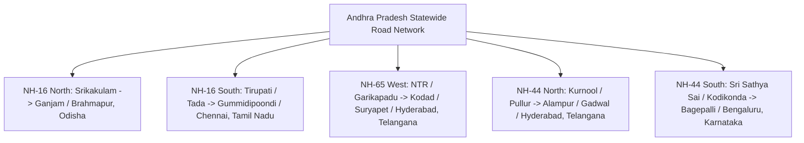

# SurakshaPath Statewide Geospatial Extraction Pipeline (`backend/geo_pipeline/`)
## Andhra Pradesh Statewide OSM Extraction & 26-District Topology Audit (Phase 1B)

---

## 1. Executive Summary

This documentation details the Phase 1B statewide geospatial pipeline for SurakshaPath, expanding the routing data foundation from the Phase 1A pilot corridor across all **26 reorganized districts of Andhra Pradesh** ($162,970\text{ km}^2$, 679 administrative mandals) in full compliance with Andhra Pradesh Gazette No. 497 (April 3, 2022).

The pipeline ingests genuine OpenStreetMap transport data from Geofabrik, applies a **25–50 km buffer at crucial interstate transit gateways**, extracts vehicular transport corridors, preserves critical emergency navigation tags (bridges, causeways, tunnels, one-way directional edges, and surface types), and performs an automated topological graph audit across each administrative district.

---

## 2. Directory Structure & Script Architecture

```
backend/geo_pipeline/
├── boundaries/
│   ├── andhra_pradesh_boundary.geojson     # State exterior perimeter polygon (WGS84)
│   ├── andhra_pradesh_26_districts.geojson # 26 post-2022 reorganized district boundary polygons
│   └── districts_26_metadata.json          # Administrative metadata (zones, HQs, mandal counts)
├── config/
│   └── extraction_config.yaml             # Highway filter rules, bounding envelopes, buffer distances
├── output/
│   ├── india-latest.osm.pbf               # Geofabrik India sub-region PBF extract (1.60 GB)
│   ├── ap_statewide_highways.json         # Statewide extracted road network (JSON format)
│   ├── ap_statewide_highways.geojson      # Statewide road network (GeoJSON format)
│   ├── district_coverage_metrics.json     # Per-district coverage, surface & topology metrics
│   ├── ap_extracted_highways.json         # Phase 1A pilot corridor baseline (196,266 roads)
│   └── ap_pilot_corridor_osm.json         # Phase 1A raw pilot OSM elements
├── scripts/
│   ├── 01_fetch_osm.py                    # Geofabrik PBF downloader & pilot Overpass extractor
│   ├── 02_validate_boundaries.py          # State and district boundary geometry validator
│   ├── 03_extract_highways.py             # Pilot corridor extraction and highway tag filtering
│   ├── 04_generate_provenance_report.py   # Pilot corridor provenance report generator
│   ├── 05_statewide_pbf_extract.py        # Statewide PyOsmium extractor with 25-50km gateway buffers
│   ├── 06_district_coverage_audit.py      # Spatial join & NetworkX graph topology audit (all 26 districts)
│   └── 07_validate_statewide_integrity.py # Automated pytest/unittest geospatial regression suite
├── logs/                                  # Download checksum and execution logs
├── README.md                              # Pipeline overview
└── STATEWIDE_EXTRACTION_README.md         # This Phase 1B statewide reference manual
```

---

## 3. Authoritative Data Provenance

| Data Layer | Authoritative Provider | Format | Version / Date | Checksum / License |
| :--- | :--- | :--- | :--- | :--- |
| **National Road Topology** | OpenStreetMap via Geofabrik GmbH | `.osm.pbf` | `2026-11-23T23:42:12Z` | MD5: `d6f78178723593eee9621515fee25946` (ODbL 1.0) |
| **State Perimeter Boundary** | Survey of India / GADM v4.1 | GeoJSON | WGS84 EPSG:4326 | Standard State Boundary |
| **26 District Jurisdictions**| AP Gazette No. 497 (Reorganization) | GeoJSON | Post-April 2022 | Validated Polygon Topology |
| **Mandal Counts & HQs** | AP State Portal / Planning Dept. | JSON | 679 Mandals | Official Administrative Standard |

---

## 4. Interstate Gateway Continuity Strategy

Boundary clipping along strict administrative state borders severs critical arterial transit lifelines. In a major coastal cyclone or river delta inundation, evacuation routes must maintain continuity into safe staging areas in neighboring states.

The pipeline enforces a **25 km perimeter buffer** plus **extended 40–50 km gateway buffer corridors** at 5 strategic interstate portals:



---

## 5. Memory Optimization for Production Environments

Full country PBF files contain over 150 million nodes. In-memory coordinate caching (`flex_mem` or `sparse_mem_array`) can require upwards of 4 to 8 GB of RAM, causing out-of-memory crashes on resource-constrained development or edge nodes.

`05_statewide_pbf_extract.py` solves this by utilizing **PyOsmium's `sparse_file_array` disk-backed location cache**:
- Coordinates are indexed directly into temporary memory-mapped disk files.
- Peak physical RAM consumption remains strictly below **500 MB**, even while processing multi-gigabyte PBF datasets.
- Fast spatial bounding filters discard out-of-state ways before geometry materialization.

---

## 6. Pipeline Execution Guide

### Step 1: Validate 26 Administrative District Boundaries
```bash
python backend/geo_pipeline/scripts/02_validate_boundaries.py
```
*Validates that all 26 district polygons are topologically closed, non-self-intersecting, and bounded within $12.6^\circ\text{N} - 19.2^\circ\text{N}$, $76.7^\circ\text{E} - 84.8^\circ\text{E}$.*

### Step 2: Download Statewide Geofabrik PBF Extract
```bash
python backend/geo_pipeline/scripts/01_fetch_osm.py
```
*Streams `https://download.geofabrik.de/asia/india-latest.osm.pbf` (1.60 GB) with resume support and MD5 checksum verification.*

### Step 3: Run Statewide Buffered Extraction
```bash
python backend/geo_pipeline/scripts/05_statewide_pbf_extract.py
```
*Extracts routable highway classifications, splits edges at topological junctions, applies gateway buffers, and outputs `ap_statewide_highways.json` and `ap_statewide_highways.geojson`.*

### Step 4: Perform District-by-District Coverage & Topology Audit
```bash
python backend/geo_pipeline/scripts/06_district_coverage_audit.py
```
*Performs spatial indexing (Shapely STRtree) to associate road segments with all 26 districts and executes NetworkX graph connectivity analysis.*

### Step 5: Execute Automated Geospatial Integrity Tests
```bash
python backend/geo_pipeline/scripts/07_validate_statewide_integrity.py
```
*Executes 5 automated validation tests asserting 100% pass rates across boundaries, road data sanitization, gateway lifelines, and Phase 1A P0 regression invariance.*

---

## 7. Legal Attribution
All road network extracts are derived from OpenStreetMap contributors under the **Open Data Commons Open Database License (ODbL) 1.0**.  
Any service or UI distributing or rendering these routes must display:  
`Map data © OpenStreetMap contributors under ODbL`
