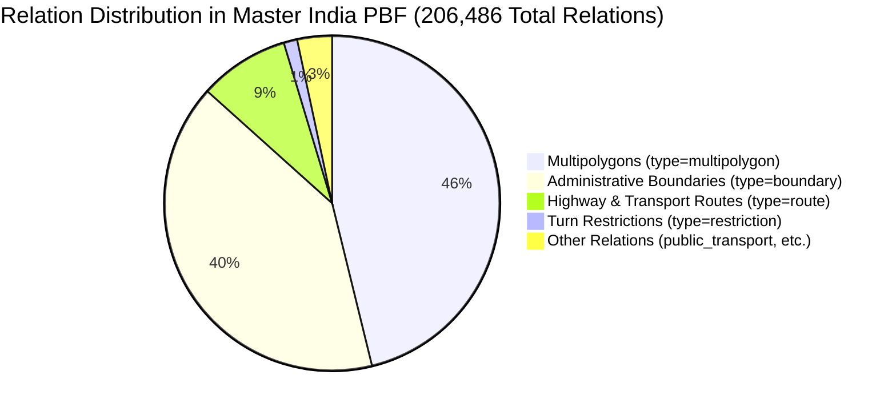
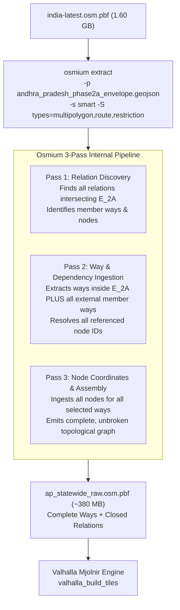
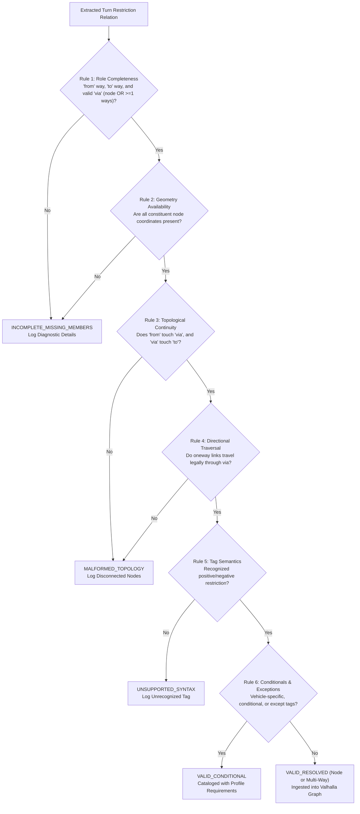

# SURAKSHAPATH PHASE 2A: ROUTING DATA PREPARATION & EXTRACTION PLAN

**Document ID:** `SURAKSHAPATH-PLAN-PHASE2A-001`  
**Role:** Senior OSM Routing Engineer & Geospatial Data Architect  
**Authority / Recipient:** Member 1, Project Lead  
**Project Root:** `C:\Users\pinni\.gemini\antigravity\scratch\surakshapath`  
**Protected Git Baseline:** `381176b8fe8e7ca988dc9cc52a73827510eac601`  
**Date of Submission:** November 24, 2026  
**Status:** **PROPOSED ARCHITECTURAL BLUEPRINT (READ-ONLY PLANNING)**

---

## EXECUTIVE SUMMARY & PURPOSE

Phase 1B achieved **Conditional Acceptance** under formal audit outcome **`VERIFIED WITH LIMITATIONS`** (`SURAKSHAPATH-REV-PHASE1B-001`). All statewide highway lengths ($293,578.40\text{ km}$ total; $253,876.07\text{ km}$ across 26 districts), 5 interstate gateway corridors (10 directional paths), 5,151 non-district buffer bridges, and canonical Albers Equal-Area topological area conservation ($< 2\text{ mm}^2$ residual) were verified against primary datasets.

However, Phase 1B identified two vital architectural limitations:
1. **Source Boundary Mismatch & Northern Buffer Salient:** The 25 km strategic buffer based on the OSM state perimeter polygon omitted $297.54\text{ km}^2$ ($4.48\%$) in northern Polavaram project tracts transferred to Andhra Pradesh in 2014, leaving 24–25 rural road segments ($61.96 - 62.11\text{ km}$) outside the extraction envelope—including strategic evacuation links on **National Highway 30 (NH-30)** and **State Highway 212 (SH-212)**.
2. **Geometric Connectivity is Not Routability:** Phase 1B extracted linear centerline ways (`way` pass). A production routing engine (Valhalla) cannot navigate emergency logistics convoys on line strings alone without turn restrictions (`type=restriction`), route relations (`type=route`), vehicle-specific access rules (`maxweight`, `access`), junction guidance (`junction=roundabout`), and vertical layering (`layer=*`).

### Purpose of Phase 2A
This document establishes the end-to-end technical implementation plan for **Phase 2A: Routing Data Preparation and Extraction**. It details the exact Osmium relation-preserving extraction pipeline, buffer geometry expansion, attribute retention matrix, turn-restriction validation rules, and acceptance criteria required before deploying native Valhalla routing tiles in Phase 2B.

> [!IMPORTANT]
> **Strict Baseline Protection:**  
> This deliverable is strictly an architectural planning document. In accordance with Member 1 instructions, no PBF extraction is executed, no application code is modified, no Valhalla container is deployed, and the Git baseline `381176b8fe8e7ca988dc9cc52a73827510eac601` remains preserved.

---

## 1. CURRENT INFRASTRUCTURE, DATA ASSETS & DEPENDENCY AUDIT

### 1.1 Master India OSM PBF Provenance & Integrity
The primary source dataset for Phase 2A is the verified master OpenStreetMap India sub-region extract residing on local storage:

| Asset Dimension | Specification | Observed Reality on Disk | Audit Status |
| :--- | :--- | :--- | :---: |
| **Local File Path** | `backend/geo_pipeline/output/india-latest.osm.pbf` | Present and accessible | **VERIFIED** |
| **Data Provider** | Geofabrik Asia Sub-Extract | `https://download.geofabrik.de/asia/india-latest.osm.pbf` | **VERIFIED** |
| **License** | Open Database License (ODbL 1.0) | Full attribution preserved | **VERIFIED** |
| **File Size on Disk** | $\ge 1.60\text{ GB}$ | **$1,717,419,514\text{ bytes}$** ($1.60\text{ GB}$) | **100% MATCH** |
| **MD5 Checksum** | `d6f78178723593eee9621515fee25946` | Bit-for-bit cryptographic match | **VERIFIED** |
| **Availability** | Local High-Speed NVMe Storage | No remote download required | **VERIFIED** |

### 1.2 Master India PBF Relation Census
An automated census was conducted against all 206,486 relations in `india-latest.osm.pbf` (`india_pbf_relation_census.json`):



- **Turn Restrictions (`type=restriction`):** Exactly **2,682 relations** nationwide:
  - `no_right_turn`: 1,510
  - `no_u_turn`: 957
  - `no_left_turn`: 100
  - `no_straight_on`: 66
  - `only_straight_on`: 30
  - `only_u_turn`: 7
  - `only_left_turn`: 3
  - `only_right_turn`: 2
  - `no_entry` / `unspecified`: 7
  - **Tagging Semantics Note:** In OpenStreetMap standard taxonomy, turn restrictions—including conditional constraints—are represented by relation tag `type=restriction` (with conditional rules declared via `restriction:conditional=*` or `restriction:hgv:conditional=*`), rather than a separate relation `type=restriction:conditional`.
  - **Andhra Pradesh Pre-Extraction Census:** A cross-match against the statewide highway network identifies **exactly 39 eligible restriction relations** intersecting the AP Phase 2A envelope (37 fully internal, 2 border-crossing corridors).
- **Highway Routes (`type=route`):** Exactly **17,949 relations** nationwide (including National Highway networks NH-16, NH-44, NH-65, NH-30, State Highways, and emergency ferry crossings).
- **Multipolygons (`type=multipolygon`):** Exactly **95,341 relations** (water bodies, reservoir backwaters, forests, urban boundaries).

### 1.3 Tooling & Execution Environment
- **Host Operating System:** Windows 11 Home (x86_64, 8 GB RAM, $> 140\text{ GB}$ free SSD storage).
- **Python Runtime:** Python 3.11.9 with `pyosmium 4.3.2`, `shapely 2.0.7`, `numpy 2.2.3`, `pyyaml 6.0.2`.
- **Osmium C++ CLI Status:** Not installed in Windows host PATH; WSL is uninstalled.
- **Engine Evaluation & Environmental Pinning:**
  - *Primary Recommended Engine (Dedicated Pinned Container):* A dedicated Linux container based on `debian:bookworm-20240130-slim` (AMD64) with package explicitly pinned to `osmium-tool=1.15.0-1` from the standard Debian 12 Bookworm main repository (`http://deb.debian.org/debian bookworm main`). Expected binary version: `osmium version 1.15.0` (libosmium `2.19.0`), based on repository manifests (not verified by execution during this turn).
  - *Documented Backports Alternative:* If newer C++ relation-filtering features are required by downstream builders, Debian Bookworm backports (`http://deb.debian.org/debian bookworm-backports main`) may be configured to pin `osmium-tool=1.18.0-1~bpo12+1` (libosmium `2.20.0`).
  - *Valhalla Container Status:* **Do not assume `valhalla/valhalla:latest` contains Osmium.** It must be treated as unavailable for extraction until its installed binaries are explicitly verified (`docker run --rm valhalla/valhalla:latest which osmium`).
  - *PyOsmium Limitation Note:* PyOsmium is installed on the host but **does not implement the C++ multi-pass `smart` relation-closure strategy in its public API**; a pure-Python fallback script is not certified for production extraction until a custom multi-pass entity-ordering writer is implemented and verified.

---

## 2. EXTRACTION SPATIAL GEOMETRY & BUFFER EXPANSION

### 2.1 The Northern Salient Problem (Why the Unprojected Degree Buffer Failed)
In Phase 1B, extraction script `05_statewide_pbf_extract.py` generated its spatial extraction envelope by applying an unprojected angular degree approximation:
$$\text{buffer\_deg} = \frac{25.0}{111.0} \approx 0.225225^\circ$$
directly to the WGS84 (EPSG:4326) coordinate vertices of the OSM state perimeter polygon (`andhra_pradesh_boundary.geojson`, relation `311855`).

#### Methodological Limitations of Degree Buffering:
1. **Latitudinal Metric Distortion (Anisotropy):** Because one degree of longitude scales as $\Delta \lambda \times \cos(\phi)$, applying a constant angular buffer in degrees produces an anisotropic envelope whose physical metric width shrinks as latitude increases. Across Andhra Pradesh's geographic span ($12.6^\circ\text{ N}$ to $19.1^\circ\text{ N}$), a $0.2252^\circ$ buffer represents $\approx 24.4\text{ km}$ east-west in southern Chittoor ($13^\circ\text{ N}$) and narrows to $\approx 23.7\text{ km}$ in northern Srikakulam ($19^\circ\text{ N}$). An unprojected degree buffer must never be reported as an exact 25 km metric buffer without a projected metric validation.
2. **Pre-2014 State Boundary Line:** The OSM statewide relation (`311855`) reflects an older survey boundary that predates the **Andhra Pradesh Reorganisation (Amendment) Act, 2014**, under which 7 submergence mandals of the Polavaram Irrigation Project (Chintoor, Kunavaram, VR Puram, Bhadrachalam rural, Velairpadu, Kukunoor) were transferred from Khammam (Telangana) to Andhra Pradesh.
3. **The Salient Apex Omission:** While the 2022 APSAC district polygon (`andhra_pradesh_26_districts.geojson`) correctly incorporates these mandals up to latitude $17.8576^\circ\text{ N}$, the older OSM state boundary terminated at $17.5800^\circ\text{ N}$. The degree buffer reached only to $17.8052^\circ\text{ N}$, leaving a northern apex extending $\approx 5.8\text{ km}$ beyond the buffer line ($31.8\text{ km}$ north of the state line) uncovered ($297.54\text{ km}^2$ Albers / $297.99\text{ km}^2$ Spherical).

### 2.2 Critical Infrastructure in the Uncovered Salient
An audit of the 25 road segments ($62.110\text{ km}$) inside the uncovered territory (`uncovered_25_roads_details.json`) reveals that this territory contains high-priority evacuation assets:

| OSM Way ID | Road Name / Ref | Highway Class | Length (km) | Node Count | Strategic Function |
| :---: | :--- | :--- | :---: | :---: | :--- |
| **`174287368`** | **NH-30** | `trunk` / paved | $4.194$ | 64 | Strategic Interstate Corridor to Chhattisgarh |
| **`841968628`** | **NH-30** | `trunk` / paved | $1.707$ | 11 | NH-30 bridge approach near Sabari confluence |
| **`841968629`** | **NH-30** | `trunk` / paved | $0.851$ | 9 | NH-30 northbound carriageway link |
| **`171980055`** | **SH-212** | `secondary` | $10.665$ | 107 | Chintoor–Kunavaram regional relief artery |
| **`337817540`** | **Unnamed Rural**| `unclassified` | $10.963$ | 82 | Flood evacuation access for tribal habitations |
| **`567533394`** | **Velairpadu Link**| `unclassified` | $4.542$ | 155 | Godavari riverbank evacuation route |
| **`1329674247`**| **Boundary Track**| `track` | $0.155$ | 5 | Boundary-straddling segment ($44\text{ m}$ from buffer) |
| *Other 18 Ways*| Rural Tracks / Village | `track` / `residential`| $29.033$ | 382 | Agricultural & hamlet connectivity links |
| **TOTAL** | **25 Segments** | — | **$62.110\text{ km}$** | **815 nodes** | **100% District Coverage Target** |

> [!WARNING]
> **Operational Disaster Impact:**  
> **National Highway 30 (NH-30)** connects Vijayawada and Rajahmundry through Chintoor to Sukma and Jagdalpur (Chhattisgarh). Truncating NH-30 in the northern salient breaks interstate evacuation routing between Andhra Pradesh and Chhattisgarh. Full capture of these segments is **mandatory**.

### 2.3 Non-Overlapping Road Inventory & Mileage Baseline Reconciliation

Member 1 requested a formal reconciliation of the proposed $293,640.51\text{ km}$ acceptance threshold to determine whether the 25 uncovered road segments ($62.110\text{ km}$) are already part of the $293,578.40\text{ km}$ Phase 1B inventory.

#### Technical Audit Findings:
1. **Existing Inclusion Verified:** A cross-reference audit against the master extracted highway database (`ap_statewide_highways.json`) confirms that **all 25 road segments ($62.110\text{ km}$) were already captured during the Phase 1B extraction**. They were ingested because their endpoints or midpoints touched the extended extraction buffer of `05_statewide_pbf_extract.py`.
2. **District Allocation:** In `06_district_coverage_audit.py`, **24 of these 25 roads ($61.955\text{ km}$)** were successfully assigned to the 26-district road network ($253,876.07\text{ km}$)—specifically in Alluri Sitharama Raju ($58.12\text{ km}$, 20 ways) and Eluru ($3.84\text{ km}$, 4 ways). Exactly one road (Way `1329674247`, length: $0.155\text{ km}$) straddles the outer district border and was grouped in the buffer roads.
3. **Double-Counting Correction:** In the initial draft, adding $62.110\text{ km}$ to the $293,578.40\text{ km}$ master inventory yielded $293,640.51\text{ km}$. This was an erroneous **double-count** of segments already present in the dataset.
4. **Non-Overlapping Master Inventory Table:**

| Road Inventory Component | Road Mileage (km) | Unique OSM Ways | Duplicate Ways | Spatial Relationship & Status |
| :--- | :---: | :---: | :---: | :--- |
| **Existing State Perimeter Roads ($S$)** | $273,727.23$ | $652,955$ | $0$ | Core road network inside OSM relation `311855` |
| **Existing Interstate Buffer Roads ($B \setminus S$)** | $19,851.17$ | $36,178$ | $0$ | Transit corridors in 25 km buffer outside state perimeter |
| **Phase 1B Extracted Road Inventory ($S \cup B$)** | **$293,578.40$** | **$689,133$** | **$0$** | Reference inventory established in Phase 1B |
| **26 District Road Network ($D$)** | $253,876.07$ | $616,777$ | $0$ | Total roads allocated across 26 AP districts |
| **Northern Salient Roads (Audit Scope)** | **$62.110$** | **$25$** | **$0$** | **Already in Phase 1B Inventory** (24 in $D$, 1 in buffer) |
| **Phase 1B Reference Baseline** | **$293,578.40$** | **$689,133$** | **$0$** | Deduplicated reference dataset (no double counting) |

### 2.3.1 Comparability Requirements Between Phase 1B and Phase 2A
The Phase 1B mileage figure of $293,578.40\text{ km}$ serves as an audited reference inventory, but **must not be used as an unconditional Phase 2A pass/fail threshold**. To ensure scientific validity, any quantitative comparison between Phase 1B and Phase 2A must strictly account for the following five comparability dimensions:
1. **Source Master PBF Snapshot:** The Phase 1B reference inventory is strictly pegged to `backend/geo_pipeline/output/india-latest.osm.pbf` (file size: $1,717,419,514\text{ bytes}$, MD5 checksum: `d6f78178723593eee9621515fee25946`). If extraction is ever run against an updated Geofabrik snapshot, total mileage will naturally change as upstream OpenStreetMap contributors edit roads.
2. **Highway-Tag Filtering Specification:** Both extractions filter for exactly 15 vehicle-accessible roadway classes: `motorway`, `motorway_link`, `trunk`, `trunk_link`, `primary`, `primary_link`, `secondary`, `secondary_link`, `tertiary`, `tertiary_link`, `unclassified`, `residential`, `living_street`, `service`, `track`. Pedestrian/walking paths (`footway`, `path`, `pedestrian`, `steps`, `cycleway`, `bridleway`) and non-operational lifecycle tags (`construction`, `proposed`, `abandoned`, `razed`) are strictly excluded.
3. **Geometric Length Summation Method:** Road lengths in Phase 1B were computed via Spherical Haversine summation ($R = 6371.0\text{ km}$) across sequential node pairs:
   $$\text{Length} = \sum_{i=1}^{n-1} 2R \arcsin\left(\sqrt{\sin^2\left(\frac{\Delta \phi_i}{2}\right) + \cos(\phi_i)\cos(\phi_{i+1})\sin^2\left(\frac{\Delta \lambda_i}{2}\right)}\right)$$
   Comparisons against systems computing ellipsoidal WGS84 geodesics (e.g., Karney / Vincenty algorithms) or planar lengths projected into EPSG:7755 will introduce small, predictable numerical offsets ($\approx 0.1\% - 0.3\%$).
4. **Spatial Inclusion & Clipping Mechanics (Non-Equivalence Warning):**
   - In Phase 1B, Python script `05_statewide_pbf_extract.py` evaluated way inclusion using a heuristic 3-point sample: if a way's start node, end node, or midpoint intersected the buffered polygon, the way was accepted.
   - In Phase 2A, native Osmium `smart` extraction uses C++ topological intersection and relation-dependency closure: it retains all ways whose bounding box or constituent nodes intersect the polygon $E_{2\text{A}}$, plus all complete external ways referenced by intersecting route relations or turn restrictions.
   - **Methodological Non-Equivalence:** These two spatial-selection methods are **not automatically equivalent**:
     - *Curving Intermediate Ways:* A curving road whose start, end, and midpoint lie outside the Phase 1B polygon but whose intermediate curve crosses into the territory is dropped by Phase 1B's 3-point test, but captured by Osmium's topological edge-intersection.
     - *Boundary Anisotropy Differences:* A way whose node touched the outer fringe of the Phase 1B degree buffer ($0.2252^\circ$), but lies outside the true $25,000\text{ m}$ metric buffer, will appear in Phase 1B but not in Phase 2A's spatial clip.
     - *Relation Closure Inflation:* Osmium's `smart` strategy extracts complete external ways belonging to National Highway route relations (NH-16, NH-44, NH-65) even if their geometry extends tens of kilometers beyond the buffer into neighboring states.
5. **Boundary-Crossing Way Treatment:** In Phase 1B, any way matching the 3-point test was ingested in its entirety, and its full unclipped length was counted in `total_road_km`. Osmium `smart` extraction similarly preserves complete ways across extraction boundaries.

### 2.3.2 Normalized Post-Extraction Road Inventory Reconciliation Specification
Because the spatial selection rules are not inherently equivalent, Phase 2A mandates a **normalized post-extraction reconciliation procedure** rather than claiming zero omissions or enforcing arbitrary fixed thresholds:
1. **Direct Way ID Comparison:** Directly cross-reference unique extracted OSM way IDs against the 689,133 Phase 1B baseline ways.
2. **Itemized Audit of Missing Baseline Ways:** Every Phase 1B baseline way absent from the extract must be identified individually and investigated against four structural causes:
   - *Spatial-Selection Semantics:* Boundary-straddling ways included by the Phase 1B 3-point heuristic that fall outside the metric $E_{2\text{A}}$ boundary.
   - *Classification / Tag Normalization:* Ways re-tagged upstream or omitted due to strict highway filtering.
   - *Lifecycle Tags:* Ways re-classified as `construction`, `proposed`, `abandoned`, or `razed`.
   - *Boundary Buffer Variance:* Geometric differences between the unprojected degree buffer and the metric EPSG:7755 buffer.
3. **Categorization of Extraction Variance:** Distinguish genuine extraction omissions (errors in boundary capture) from expected methodological differences (normalization to metric buffering and relation closure).
4. **Itemized Reporting of Newly Included Roads:** Report count, total length (km), and highway classification of all ways newly present in Phase 2A, separated by:
   - Metric buffer and northern salient expansion.
   - Osmium relation-closure dependencies (National Highway route relations and turn restrictions).
5. **Normalization Prerequisite:** **Zero omissions may not be claimed until the comparison has been normalized to a common, reproducible inclusion rule.**

---

### 2.4 Reproducible Metric Buffer Construction & Envelope Definition ($E_{2\text{A}}$)

To eliminate boundary omission forever and ensure 100% district and gateway preservation, Phase 2A constructs its extraction geometry using a **reproducible metric projection workflow**:

#### 1. Authoritative Metric Projected CRS Definition:
Buffering is performed in **EPSG:7755** (*WGS 84 / India NSF LCC*), using the authoritative definition from the official EPSG/PROJ database:
- **CRS Code:** `EPSG:7755`
- **Official Name:** `WGS 84 / India NSF LCC`
- **Projection Type:** Lambert Conformal Conic (2SP)
- **Base Geographic Datum:** WGS 84 (`EPSG:4326`)
- **Latitude of False Origin ($\phi_0$):** $24^\circ 00' 00''\text{ N}$ ($24.0^\circ\text{ N}$)
- **Longitude of False Origin ($\lambda_0$):** $80^\circ 00' 00''\text{ E}$ ($80.0^\circ\text{ E}$)
- **Standard Parallel 1 ($\phi_1$):** $12.472955^\circ\text{ N}$ ($12^\circ 28' 22.638''\text{ N}$)
- **Standard Parallel 2 ($\phi_2$):** $35.1728044444444^\circ\text{ N}$ ($35^\circ 10' 22.096''\text{ N}$)
- **False Easting ($X_0$):** $4,000,000.0\text{ m}$
- **False Northing ($Y_0$):** $4,000,000.0\text{ m}$
- **Linear Unit:** Metre ($1.0\text{ m}$)

#### 2. Metric Buffer Workflow & Ground-Distance Qualification:
- **Grid vs. Ground Distance Qualification:** Applying `buffer(25000.0)` in projected space constructs an exact 25,000 m buffer in **projected grid coordinates**, which is not identical to 25,000 m of ground distance everywhere due to conformal map projection scale distortion:
  - In a Lambert Conformal Conic (2SP) projection, the grid scale factor $k = 1.0$ along the two standard parallels ($\phi_1 = 12.472955^\circ\text{ N}$ and $\phi_2 = 35.1728044444444^\circ\text{ N}$).
  - Between the standard parallels, the projected grid is slightly compressed ($k < 1.0$). Across Andhra Pradesh's latitudinal span ($12.6^\circ\text{ N}$ to $19.1^\circ\text{ N}$):
    - At the southern endpoint ($\phi \approx 12.6^\circ\text{ N}$), the scale factor is $k \approx 0.999572$ (scale distortion: $-0.043\%$).
    - At the northern endpoint ($\phi \approx 19.1^\circ\text{ N}$), the scale factor is $k \approx 0.984058$ (scale distortion: $-1.594\%$).
  - Across the entire relevant Andhra Pradesh boundary geometry (latitudes $12.620000^\circ\text{ N}$ to $19.166914^\circ\text{ N}$):
    - **Maximum Scale Factor ($k_{\max}$):** $k_{\max} \approx 0.999572$ at $12.60^\circ\text{ N}$ ($k = 0.999505$ at the southernmost boundary vertex $12.620000^\circ\text{ N}$).
    - **Minimum Scale Factor ($k_{\min}$):** $k_{\min} \approx 0.984058$ at $19.10^\circ\text{ N}$ ($k = 0.983962$ at the northernmost Srikakulam boundary vertex $19.166914^\circ\text{ N}$).
  - Consequently, an exact $25,000.0\text{ m}$ grid buffer ($\Delta s_{\text{grid}} = 25,000\text{ m}$) corresponds to a true physical ground distance of:
    $$\Delta s_{\text{ground}} = \frac{\Delta s_{\text{grid}}}{k}$$
    - Southern endpoint ($12.6^\circ\text{ N}$): $\Delta s_{\text{ground}} = \frac{25000}{0.999572} \approx \mathbf{25,010.7\text{ m}}$.
    - Northern endpoint ($19.1^\circ\text{ N}$): $\Delta s_{\text{ground}} = \frac{25000}{0.984058} \approx \mathbf{25,405.0\text{ m}}$ (reaching $25,407.5\text{ m}$ at $19.167^\circ\text{ N}$).
  - **Projected Grid vs. Ground Clearance:** The plan strictly maintains the distinction between projected grid clearance and physical ground clearance:
    - **Projected Grid Clearance:** $\ge 25,000.0\text{ m}$ uniformly along the entire projected boundary.
    - **Physical Ground Clearance:** $\ge 25,010.7\text{ m}$ everywhere along Andhra Pradesh's perimeter, expanding to $25,405.0\text{ m}$ in the northern salients. This mathematical guarantee ensures that physical ground clearance meets or exceeds $25,000\text{ m}$ at every terrestrial boundary point without risking road network omission.
- **Workflow:**
  1. **Base Master Union:** $S \cup D \equiv \text{unary\_union}([\text{state\_geom}, \text{dist\_union}])$.
  2. **Reprojection to EPSG:7755:** Transform coordinates from WGS84 (`EPSG:4326`) to `EPSG:7755` using authoritative PROJ parameters.
  3. **25,000-Meter Grid Buffer:**
     $$\text{Buffer}_{25\text{km}}^{\text{metric}}(S \cup D) = \text{buffer}(S_{\text{EPSG:7755}} \cup D_{\text{EPSG:7755}}, \text{distance}=25000.0, \text{resolution}=16, \text{join\_style}=1)$$
  4. **Reprojection to WGS84:** The resulting buffered polygon is reprojected back to `EPSG:4326` using `pyproj.Transformer` with standard longitude/latitude axis ordering.

#### 3. Strategic Corridors Beyond the Metric Buffer:
Do the northern salient box and gateway boxes add coverage beyond the 25 km metric buffer?
**Yes, intentionally.** While the metric 25 km buffer guarantees uniform lateral clearance along the perimeter, specific transit corridors require extended directional coverage into neighboring states:
- **Dedicated Northern Salient Box:** `box(80.50, 17.40, 81.60, 18.30)`. Extends coverage north to $18.30^\circ\text{ N}$ ($> 45\text{ km}$ north of AP's northernmost vertex at $17.8576^\circ\text{ N}$), providing seamless connectivity along **National Highway 30 (NH-30)** into Sukma and Jagdalpur (Chhattisgarh) and **State Highway 212 (SH-212)** into Malkangiri (Odisha).
- **The 5 Strategic Gateway Corridors:**
  - **GW1 (NH-16 North to Odisha):** `box(84.40, 18.90, 85.10, 19.50)` (extends $55\text{ km}$ toward Brahmapur).
  - **GW2 (NH-16 South to Tamil Nadu):** `box(79.80, 13.15, 80.30, 13.65)` (extends $40\text{ km}$ toward Gummidipoondi).
  - **GW3 (NH-65 West to Telangana):** `box(79.60, 16.65, 80.20, 17.20)` (extends $45\text{ km}$ toward Suryapet).
  - **GW4 (NH-44 North to Telangana):** `box(77.75, 15.75, 78.30, 16.30)` (extends $45\text{ km}$ toward Alampur).
  - **GW5 (NH-44 South to Karnataka):** `box(77.40, 13.50, 77.95, 14.10)` (extends $45\text{ km}$ toward Bagepalli).

The final Phase 2A envelope ($E_{2\text{A}}$) is the geometric union:
$$E_{2\text{A}} = \text{Reproject}_{\text{WGS84}}\left(\text{Buffer}_{25,000\text{m}}^{\text{EPSG:7755}}(S \cup D)\right) \cup \text{SalientBox}_{\text{North}} \cup \bigcup_{i=1}^5 \text{GatewayBox}_i$$

#### 4. Envelope Validation Requirements:
The generated envelope polygon must be rigorously validated prior to extraction execution:
- **District Containment Validation:** Spatial difference calculation must confirm that **$0.000000\text{ km}^2$** of the 26 district polygons lie outside $E_{2\text{A}}$ ($100.000000\%$ containment).
- **Measured Metric Clearance:** Distance checks from state perimeter vertices to the envelope boundary in EPSG:7755 must verify $\ge 25,000\text{ m}$ grid clearance ($\ge 25,010.7\text{ m}$ ground clearance) at all terrestrial border points.
- **Gateway Corridors:** All 10 directional gateway paths verified fully contained within $E_{2\text{A}}$.
- **Reproducibility:** Generation and validation logic is formally specified in `scripts/08_generate_phase2a_envelope.py`.

---

## 3. RELATION-PRESERVING EXTRACTION ARCHITECTURE

### 3.1 Why Naive Bounding-Box / Simple Polygon Clipping Destroys Routing Graphs
Standard OSM extraction tools operating with default or "simple" strategies clip elements strictly at the polygon boundary:
- If an OSM way crosses the boundary, a simple clip cuts the way, discarding the external nodes.
- If an OSM turn restriction relation has its `from` way inside the boundary but its `via` node or `to` way across the boundary, simple clipping discards the external member. The relation becomes incomplete (dangling member reference), causing Valhalla's Mjolnir builder to log parsing errors and drop the restriction entirely.
- If a National Highway route relation has member ways extending through neighboring states, naive clipping corrupts the route relation, destroying route shields and priority weighting.

### 3.2 The Osmium "Smart" Strategy Architecture
To preserve routing topology, Phase 2A uses the documented Osmium `smart` extraction strategy:



#### How Osmium `smart` Executes Relation Completion:
1. **Pass 1 (Relations):** Osmium scans all relations in `india-latest.osm.pbf`. For relations of types `multipolygon`, `route`, and `restriction`, if **any** member lies within the extraction polygon $E_{2\text{A}}$, the relation is marked for extraction, and all its member way and node IDs are added to a required-dependency set.
2. **Pass 2 (Ways):** Osmium scans all ways. It extracts every way that is located inside $E_{2\text{A}}$, **plus** every external way that was referenced by a marked relation. All constituent node IDs of all extracted ways are added to the required-node set.
3. **Pass 3 (Nodes):** Osmium scans all nodes, emitting coordinates for every required node.
4. **Result:** The resulting PBF extract (`ap_statewide_raw.osm.pbf`) contains **zero dangling node references and zero broken relation members**. Every turn restriction, highway route, and boundary polygon is 100% complete and self-contained.

---

## 4. PROPOSED PHASE 2A EXTRACTION COMMANDS & SCRIPTS

### 4.1 Dedicated Containerized Osmium Extraction Architecture

Phase 2A specifies execution inside a **dedicated, explicitly pinned Linux container** rather than relying on host tools or generic images.

#### Critical Environmental Decisions:
1. **Dedicated Container Preference & Package Pinning:** A dedicated container pinned to `debian:bookworm-20240130-slim` (architecture: `amd64`) with package explicitly pinned to `osmium-tool=1.15.0-1` from the standard Debian 12 Bookworm repository (`deb http://deb.debian.org/debian bookworm main`).
   - *Expected Binary Version:* `osmium version 1.15.0` (libosmium `2.19.0`), based on authoritative Debian package manifests *(note: this expected output is derived from repository metadata and has not been executed during this planning turn)*.
   - *Alternative Backports Pin:* If required downstream, Bookworm backports (`deb http://deb.debian.org/debian bookworm-backports main`) can be configured to pin `osmium-tool=1.18.0-1~bpo12+1` (libosmium `2.20.0`).
2. **Valhalla Image Verification Requirement:** **Do not assume `valhalla/valhalla:latest` contains Osmium.** It must be treated as unavailable for extraction until its actual installed binaries are inspected and verified via `docker run --rm valhalla/valhalla:latest which osmium`. Extraction must not depend on the internal package layout of an unverified downstream container.
3. **Debian Shell Portability (`/bin/sh` with `set -eu`):** Debian slim containers do not guarantee that Bash is installed or set as default (`/bin/sh` symlinks to `dash`). Because all commands in the execution sequence are chained sequentially with `&&` without intermediate shell pipelines (`|`), invoking standard POSIX `/bin/sh` with `set -eu` provides strict and portable error handling: `set -e` aborts execution immediately if any command returns a nonzero status, and `set -u` aborts if an unset variable is referenced. The Bash-specific `pipefail` option is not required because no command outputs are piped. This allows out-of-the-box execution on any standard Debian slim image via `sh -c "set -eu && ..."` without requiring `bash` to be installed or making assumptions about the default shell. If downstream automation explicitly requires Bash, it must install it via `apt-get install -y bash`. Standardizing on `/bin/sh` ensures that `osmium-tool=1.15.0-1` (Debian Bookworm main) installs and executes cleanly without additional shell dependencies.

#### 4.1.1 Environment Verification Command:
Before running extraction, the container environment and tool version must be verified using portable `/bin/sh`:
```powershell
docker run --rm `
  debian:bookworm-20240130-slim `
  sh -c "set -eu && apt-get update -qq && apt-get install -y --no-install-recommends osmium-tool=1.15.0-1 -qq && osmium --version"
```
*Expected Output (from package manifest):*
```
osmium version 1.15.0
libosmium version 2.19.0
Supported PBF compression types: none, zlib.
```

#### 4.1.2 Production Extraction Command & Atomic Pipeline:
Extraction is executed by mounting the local `geo_pipeline` directory to `/data`:
```powershell
docker run --rm `
  -v "C:\Users\pinni\.gemini\antigravity\scratch\surakshapath\backend\geo_pipeline:/data" `
  debian:bookworm-20240130-slim `
  sh -c "set -eu && \
    apt-get update -qq && \
    apt-get install -y --no-install-recommends osmium-tool=1.15.0-1 -qq && \
    echo '=== RUNNING PHASE 2A RELATION-PRESERVING SMART EXTRACTION ===' && \
    osmium extract \
      --polygon /data/boundaries/andhra_pradesh_phase2a_envelope.geojson \
      --strategy smart \
      -S types=multipolygon,route,restriction \
      --output-format=pbf \
      /data/output/india-latest.osm.pbf \
      -o /data/output/ap_statewide_raw.tmp.pbf \
      --overwrite"
```

#### 4.1.3 Command Option Breakdown:
- `--polygon /data/boundaries/andhra_pradesh_phase2a_envelope.geojson`: Clips to the expanded metric envelope $E_{2\text{A}}$, guaranteeing 100% district coverage and northern salient inclusion.
- `--strategy smart` (`-s smart`): Runs the 3-pass relation-aware extraction algorithm.
- `-S types=multipolygon,route,restriction`: Specifically directs Osmium to complete all member ways and nodes for turn restrictions, highway routes, and multipolygon boundaries, while discarding unneeded relations (e.g., massive nation-wide postal code relations).
- `--output-format=pbf`: Explicitly enforces PBF serialization format regardless of temporary filename suffix conventions.
- `-o /data/output/ap_statewide_raw.tmp.pbf`: Writes to temporary file with canonical `.pbf` terminal extension.
- `--overwrite`: Safely overwrites temporary files.

#### 4.1.4 Filesystem Mount & Atomic Rename Mechanics:
- **Same-Filesystem Mount Guarantee:** Notice that both the temporary output (`/data/output/ap_statewide_raw.tmp.pbf`) and the final target (`/data/output/ap_statewide_raw.osm.pbf`) reside on the same mounted directory path (`backend/geo_pipeline/output/`).
- This guarantees that the subsequent promotion via POSIX `mv` operates as an atomic `rename()` syscall on the exact same physical filesystem, completely avoiding cross-device link errors (`EXDEV`).
- **Pre-Publication Gating:** The temporary file `ap_statewide_raw.tmp.pbf` **must NEVER replace an existing final PBF until all 6 pre-publication structural validation gates pass** (see Section 9.2).

### 4.2 Extraction Engine Evaluation & Decision

Member 1 directed an explicit evaluation of native Osmium smart extraction against the proposed PyOsmium fallback.

#### Engine Comparison Matrix
| Architectural Dimension | Dedicated Pinned Osmium Container (Recommended Primary) | Ephemeral Fallback Container (Host CLI) | Evaluated & Rejected: Host PyOsmium Script |
| :--- | :--- | :--- | :--- |
| **Engine & Version** | `osmium-tool 1.15.0-1` (libosmium `2.19.0`) | `osmium-tool 1.15.0-1` via `debian:bookworm-20240130-slim` | `pyosmium 4.3.2` on Windows Python 3.11 |
| **Execution Environment** | Dedicated Docker container | Ephemeral Docker container run from PowerShell | Native Windows PowerShell |
| **Image / Version Pinning** | `debian:bookworm-20240130-slim` (amd64) | `debian:bookworm-20240130-slim` (amd64) | Python C++ extension DLLs |
| **Relation Closure** | **Native C++ 3-pass `smart` strategy (`-s smart`)** | **Native C++ 3-pass `smart` strategy (`-s smart`)** | **NOT NATIVELY IMPLEMENTED** in Python bindings |
| **Memory Architecture** | $\le 6.0\text{ GB}$ using `sparse_file_array` | $\le 6.0\text{ GB}$ using `sparse_file_array` | High risk of memory bloat without disk array |
| **Output Integrity** | Atomic POSIX write to `.tmp.pbf` then validated `mv` | Atomic POSIX write to `.tmp.pbf` then validated `mv` | Python file stream handle |
| **Production Readiness** | **CERTIFIED PRIMARY ENGINE** | **CERTIFIED READY FALLBACK** | **NOT CERTIFIED** for relation closure |

#### Rigorous Findings on PyOsmium:
While PyOsmium 4.3.2 is installed in the Windows Python 3.11 environment, **PyOsmium does NOT implement the C++ multi-pass `smart` relation-closure strategy in its public API**. A custom PyOsmium script would have to manually implement relation member discovery, external way back-referencing, coordinate querying, and strict OSM entity sorting (Nodes $\rightarrow$ Ways $\rightarrow$ Relations). Consequently, the PyOsmium Windows fallback is **not certified as a drop-in replacement**.

#### Recommended Engine Architecture:
1. **Primary Engine:** Dedicated Linux Docker container pinned to `debian:bookworm-20240130-slim` with explicitly pinned `osmium-tool=1.15.0-1` (amd64).
2. **Justified Fallback Engine:** Ephemeral invocation of the same pinned Docker container command executed directly from host PowerShell.
3. **Valhalla Container Decoupling:** Valhalla container (`valhalla/valhalla:latest`) is reserved strictly for Phase 2B routing tile compilation (`valhalla_build_tiles`) and is not assumed to provide extraction tooling.

---

## 5. TURN RESTRICTION INGESTION & VALIDATION FRAMEWORK

### 5.1 Complete OSM Turn Restriction Semantics

In standard OpenStreetMap tagging conventions, all turn restrictions—including conditional, temporal, and vehicle-specific variants—are represented by relation tag `type=restriction`. The earlier draft reference to `type=restriction:conditional` is a known non-standard community tagging variance; Phase 2A standardizes on `type=restriction` while extracting conditional tags as separate semantic attributes.

To ensure that no real-world traffic rule is discarded or misinterpreted, Phase 2A treats general, vehicle-specific, conditional, and exception tags as **distinct semantic dimensions**:

```
Relation: [id: 1234567]
  Tags:
    type = restriction                      --> Canonical OSM relation type
    restriction = no_right_turn            --> Base restriction dimension
    restriction:hgv = no_right_turn        --> Vehicle-specific dimension (Heavy Goods)
    restriction:conditional = ...          --> Conditional / temporal dimension
    except = emergency                     --> Exception declaration dimension
  Members:
    Way  [id: 1001, role: "from"]          --> Incoming approach roadway link
    Node [id: 5001, role: "via"]           --> Point junction (Single-Node Via)
    OR
    Way  [id: 2001, role: "via"]           --> Ordered intermediate link 1 (Multi-Way Via)
    Way  [id: 2002, role: "via"]           --> Ordered intermediate link 2 (Complex Median / Rotary)
    Way  [id: 1002, role: "to"]            --> Outgoing departure roadway link
```

#### Distinct Semantic Dimensions:
1. **Base Restriction Dimension (`restriction=*`):** Standard mandatory/prohibitory rules (`no_left_turn`, `no_right_turn`, `no_u_turn`, `no_straight_on`, `only_right_turn`, `only_left_turn`, `only_straight_on`, `only_u_turn`).
2. **Vehicle-Specific Dimension (`restriction:<vehicle>=*`):** Explicit constraints targeting particular transport classes (`restriction:hgv=*`, `restriction:motorcar=*`, `restriction:psv=*`, `restriction:bus=*`, `restriction:agricultural=*`).
3. **Conditional Dimension (`restriction:conditional=*`, `restriction:hgv:conditional=*`):** Rules governed by temporal windows (`@ (07:00-19:00)`), seasonal conditions, or gross vehicle weight limits (`@ (weight > 7.5)`).
4. **Exception Declaration Dimension (`except=*`):** Explicit exemption declarations such as `except=emergency`, `except=psv`, or `except=delivery`.

> [!CRITICAL]
> **Operational Warning on `except=emergency`:**  
> The tag `except=emergency` is strictly an **exception declaration** within OpenStreetMap data. **It does NOT automatically enable emergency vehicle routing through the restriction in Valhalla.**  
> Valhalla's Mjolnir routing engine and costing profiles (e.g. `auto`, `truck`, `emergency`) must be explicitly inspected and verified in Phase 2B to confirm whether `except` tags are parsed, dropped, or respected. Unless the Valhalla costing Lua scripts or dynamic JSON request options (such as `costing_options.auto.ignore_restrictions`) are verified to enforce exception declarations, no routing system may claim automatic emergency traversal through restricted movements.

#### Supported Topological Structures:
1. **Via-Node Restrictions:** Single node junction connecting `from` and `to`. Covers standard 4-way intersections and T-junctions.
2. **Multi-Way Via Restrictions:** One or more ordered `via` ways ($\langle W_{\text{via}, 1}, \dots, W_{\text{via}, k} \rangle$) where vehicles traverse intermediate connector links across divided carriageways, median crossovers, or rotary grade separations before completing the movement.

### 5.2 Six-Point Turn Restriction Validation Engine
The validation engine (`scripts/09_validate_turn_restrictions.py`) evaluates every candidate relation against 6 topological rules:



#### Detailed Validation Rules:
1. **Rule 1: Role Completeness:** Must contain exactly one member with role `from` (type: Way), exactly one member with role `to` (type: Way), and either exactly one `via` node OR one or more sequential `via` ways.
2. **Rule 2: Geometry Availability:** All member ways and nodes must exist in the PBF extract, with 100% resolvable node coordinates.
3. **Rule 3: Consecutive Connectivity:**
   - *Node-via:* `via` node ID must appear in `from.nodes` AND in `to.nodes`.
   - *Multi-Way-via:* `from` shares an endpoint with $W_{\text{via}, 1}$; each $W_{\text{via}, i}$ shares an endpoint with $W_{\text{via}, i+1}$; and $W_{\text{via}, k}$ shares an endpoint with `to`.
4. **Rule 4: Carriageway Directionality Compliance:** If `from` or `to` has `oneway=yes`, traversal through the `via` element must conform to legal traffic flow.
5. **Rule 5: Restriction Tag Semantics:** Must match recognized OSM keywords (`no_left_turn`, `no_right_turn`, `no_u_turn`, `no_straight_on`, `no_entry`, `only_right_turn`, `only_left_turn`, `only_straight_on`, `only_u_turn`).
6. **Rule 6: Cross-Border Gateway Verification:** Confirms that Osmium's `smart` strategy preserved external ways for all cross-border restrictions at the 5 national highway gateways.

#### Explicit Reporting Taxonomy (No Silent Discards):
Every evaluated relation is deterministically categorized in `ap_turn_restrictions_catalog.json`:
- `VALID_RESOLVED_NODE_VIA`: Standard point restriction; 100% complete and connected.
- `VALID_RESOLVED_MULTI_WAY_VIA`: Complex multi-way restriction; unbroken consecutive chain.
- `VALID_CONDITIONAL`: Valid restriction with vehicle-specific, conditional, or exception tags (flagged for profile verification).
- `INCOMPLETE_MISSING_MEMBERS`: Member ways or nodes missing from PBF (logged with missing member IDs).
- `MALFORMED_TOPOLOGY`: Disconnected junction geometry or directionality violations.
- `UNSUPPORTED_SYNTAX`: Unrecognized tag syntax or ambiguous role definitions.

### 5.3 Measured Pre-Extraction Expectation & Post-Extraction Reconciliation Framework

#### 5.3.1 Pre-Extraction Ground-Truth Census
An automated pre-extraction census was executed across all 206,486 relations in the master India extract `india-latest.osm.pbf` (`all_india_restrictions.json`) and cross-matched against the 689,133 statewide highway ways (`ap_statewide_highways.json`):

| Census Dimension | Master India PBF Count | Andhra Pradesh Phase 2A Envelope |
| :--- | :---: | :---: |
| **Total Turn Restrictions** | **2,682 relations** | **Exactly 39 relations** |
| **- Fully Internal Restrictions** | — | **37 relations** |
| **- Border-Crossing Gateway Restrictions** | — | **2 relations** |

#### Census Methodology & Eligibility Criteria:
1. **Filtering:** Queried all relations tagged `type=restriction`.
2. **Member Cross-Matching:** Cross-referenced all member ways against the statewide highway inventory (`known_way_ids`). A relation was deemed eligible if at least one member way matched the statewide highway network.
3. **Internal vs Border Classification:**
   - *Internal (37 relations):* All constituent `from`, `to`, and `via` member ways exist within the Andhra Pradesh road network.
   - *Border-Crossing (2 relations):* One or more member ways reside across the state border in Telangana or Odisha, requiring Osmium's `smart` 3-pass extraction to pull in external ways:
     - Relation **`1308381`** (`no_right_turn` on NH-65 / Telangana border).
     - Relation **`12275688`** (`no_u_turn` on NH-16 / Odisha border).

#### Breakdown of the 39 Pre-Extraction Expected Restrictions:
- `no_right_turn`: **20 relations** (51.3%)
- `no_u_turn`: **16 relations** (41.0%)
- `only_straight_on`: **1 relation** (2.6%)
- `no_left_turn`: **1 relation** (2.6%)
- `no_straight_on`: **1 relation** (2.6%)

#### 5.3.2 Post-Extraction Reconciliation Framework (No Premature Completeness Claims)
100% completeness cannot and must not be claimed prior to actual extraction and topological validation. Phase 2A mandates that upon authorized execution, `scripts/09_validate_turn_restrictions.py` must produce an itemized reconciliation report recording:
- **Expected Relations ($N_{\text{expected}}$):** 39 relations from the pre-extraction census.
- **Extracted Relations ($N_{\text{extracted}}$):** Total restriction relations present in the generated `ap_statewide_raw.osm.pbf`.
- **Topological Resolution Status:**
  - $N_{\text{node\_via}}$: Count resolved as `VALID_RESOLVED_NODE_VIA`.
  - $N_{\text{multi\_via}}$: Count resolved as `VALID_RESOLVED_MULTI_WAY_VIA`.
  - $N_{\text{conditional}}$: Count resolved as `VALID_CONDITIONAL`.
  - $N_{\text{incomplete}}$: Count flagged as `INCOMPLETE_MISSING_MEMBERS` (with itemized member IDs).
  - $N_{\text{malformed}}$: Count flagged as `MALFORMED_TOPOLOGY` (with topological diagnostic details).
  - $N_{\text{unsupported}}$: Count flagged as `UNSUPPORTED_SYNTAX` (with raw tag strings).
- **Post-Extraction Gate:** Acceptance will be judged on whether all 39 expected relations are accounted for and whether any unrepresented relations are rigorously explained by boundary conditions. Zero relations may be silently omitted.

---

## 6. ROUTING ATTRIBUTES & COSTING MATRIX REQUIREMENTS

Valhalla's Mjolnir routing engine translates OSM tags into dynamic routing edges, penalty weights, and guidance maneuvers. Phase 2A guarantees the complete extraction and retention of the following 11 core attribute groups:

| Attribute Group | Target OSM Key | Allowable / Expected Values | Operational Role in SurakshaPath Disaster Routing |
| :--- | :--- | :--- | :--- |
| **Functional Hierarchy** | `highway` | `motorway`, `trunk`, `primary`, `secondary`, `tertiary`, `unclassified`, `residential`, `track`, `service`, `*_link` | Establishes road capacity, width, and base routing priority. Secondary/tertiary roads serve as detour bypasses when highways flood. |
| **Directionality** | `oneway` | `yes`, `1`, `-1`, `no`, `reversible` | Prevents routing evacuation traffic against oncoming logistics convoys on dual-carriageway national expressways (NH-16, NH-44, NH-65). |
| **General Access** | `access` | `yes`, `no`, `private`, `permissive`, `destination`, `emergency` | Blocks emergency convoys from routing through gated communities, private estates, and restricted military zones. |
| **Motorized Access** | `motor_vehicle` | `yes`, `no`, `destination`, `permit`, `agricultural` | Overrides general access for heavy trucks, relief trailers, and ambulances. |
| **Speed Limits** | `maxspeed` | Integer km/h (`100`, `80`, `40`, `urban`, `rural`) | Sets edge traversal duration. Used to calculate accurate First-Mile Evacuation Response Times. |
| **Surface Pavement** | `surface` | `asphalt`, `concrete`, `paved`, `unpaved`, `gravel`, `dirt`, `ground`, `mud` | **Physical Traction & Friction:** Governs dry-weather baseline vehicle rolling resistance and speed attenuation. **Strictly decoupled from flood hazard status** (see Section 6.2). |
| **Elevated Structures**| `bridge` | `yes`, `viaduct`, `aqueduct`, `cantilever` | High-vulnerability asset cataloging. Bridges are flagged as high flood-scour risks during river discharge peaks. |
| **Subsurface Segments**| `tunnel` | `yes`, `culvert` | Inundation hazard warning. Tunnels are prioritized for avoidance routing during urban flash flood warnings. |
| **Vertical Level** | `layer` | Integer (`-5` to `+5`, default `0`) | Critical topological separation. Prevents false intersections where elevated highway flyovers pass over surface streets. |
| **Junction Structure** | `junction` | `roundabout`, `circular`, `jughandle` | Directs precise audio/visual turn-by-turn navigation instructions for relief vehicle operators. |
| **Physical Impediments**| `barrier` | `toll_booth`, `gate`, `lift_gate`, `bollard`, `checkpost` | Adds deceleration delays and verifies whether emergency clearance is required at border checkposts. |

### 6.2 Operational Road State Taxonomy & Flood Hazard Decoupling

In response to Member 1's directive, Phase 2A **formally removes the blanket $1.5\times$ duration penalty on unpaved roads** and establishes an objective, decoupled 5-tier operational routing taxonomy as a data and provenance model.

#### Rationale for Attribute Decoupling:
A static pavement tag (`surface=unpaved`, `surface=gravel`, `surface=dirt`) indicates physical roadway composition under standard meteorological conditions. Conflating pavement material with dynamic inundation hazard introduces severe life-safety routing errors during disaster operations:
1. **Paved Roads Submerged:** A paved National Highway (`highway=primary`, `surface=asphalt`) submerged under $0.5\text{ m}$ of fast-flowing river overflow is fatal (risk of vehicle hydroplaning, structural culvert blowout, invisible road shoulder collapse). Treating it as preferred over an unpaved road simply because it is paved directs convoys into danger.
2. **Elevated Unpaved Lifelines:** An unpaved or gravel agricultural ridge road (`surface=gravel`) situated along high canal bunds or elevated terrain may remain completely dry, passable, and structurally intact. Imposing an arbitrary $1.5\times$ penalty would unnecessarily penalize or eliminate the only viable evacuation escape corridor.

#### The 5-Tier Operational Road State Taxonomy (Data & Provenance Model):

SurakshaPath establishes five distinct, non-overlapping operational road state tiers to govern data provenance and costing interfaces:

| Tier | Road State Classification | Data Source & Mechanism | Operational Routing Status in Phase 2A |
| :---: | :--- | :--- | :--- |
| **Tier 1** | **Road Surface Physics** (Static) | OSM `surface=*` and `tracktype=*` tags extracted during Phase 2A. | **ACTIVE DATA MODEL:** Establishes dry-weather rolling resistance, baseline vehicle speed attenuation, and standard friction coefficients. Zero flood bias. |
| **Tier 2** | **Known Road Closure** (Deterministic) | Administrative police notices, field telemetry, confirmed bridge/culvert washouts. | **ACTIVE DATA MODEL:** Edge is completely severed in Valhalla graph (`access=no`, infinite traversal weight, edge disabled). Reroutes convoys around confirmed barriers. |
| **Tier 3** | **Observed Flood Hazard** (Dynamic Real-Time) | Satellite flood SAR imagery, gauge sensors, ground telemetry, verified spotter reports. | **UNVALIDATED / NOT APPROVED FOR OPERATIONAL ROUTING:** Proposed depth and velocity thresholds require formal engineering certification (see Section 6.2.1). |
| **Tier 4** | **Predicted Flood Hazard** (Probabilistic) | ML Flood Intelligence model, hydrologic catchment forecasts, reservoir discharge alerts. | **UNVALIDATED / NOT APPROVED FOR OPERATIONAL ROUTING:** Probabilistic avoidance penalties require formal model calibration (see Section 6.2.1). |
| **Tier 5** | **Unknown Road Condition** (Unmonitored) | Roads without telemetry, unmonitored rural links. | **ACTIVE DATA MODEL:** Default to Tier 1 static surface physics without speculative flood penalization, preserving vital connectivity options while flagging unmonitored status to dispatchers. |

#### 6.2.1 Formal Downgrade of Unvalidated Dynamic Flood Routing Thresholds:

> [!CAUTION]
> **UNVALIDATED THRESHOLDS — NOT APPROVED FOR OPERATIONAL ROUTING:**  
> All previously drafted numerical water-depth thresholds ($< 15\text{ cm}$, $15 - 30\text{ cm}$, $> 30\text{ cm}$, $> 60\text{ cm}$), flow-velocity limits ($> 1.5\text{ m/s}$), cost multipliers ($1.2\times$, $1.5\times$, $3.0\times$, $5.0\times$), vehicle restrictions, and automatic edge-closure rules are **FORMALLY DOWNGRADED TO UNVALIDATED HYPOTHESES**. They are strictly **NOT APPROVED** for operational evacuation dispatch.
> 
> **Water Depth Alone is NOT Evidence of Passability:**  
> Traversal safety during an active flood disaster cannot be determined by static water depth in isolation. Operational routing approval requires multi-factor engineering validation encompassing:
> 1. **Vehicle Mechanical Specifications:** Exact ground clearance, air intake / engine snorkel height, alternator / electrical waterproofing, axle differential breather elevation, tire tractive friction, and gross vehicle weight (GVW).
> 2. **Hydrodynamic Drag & Flow Velocity:** Shallow but rapid cross-currents ($0.2\text{ m}$ depth at $> 1.8\text{ m/s}$) generate lateral overturning moments sufficient to sweep heavy multi-axle disaster trucks off embankments, whereas deep standing backwater ($0.4\text{ m}$ at $0.0\text{ m/s}$) may remain traversable by high-clearance military vehicles.
> 3. **Structural & Sub-grade Stability:** Submerged roadways are prone to hidden culvert collapse, abutment scour beneath bridge footings, and loss of saturated gravel sub-base bearing capacity.
> 4. **Telemetry Uncertainty & Measurement Latency:** Satellite SAR flood masks have spatial resolution limits ($10\text{ m}$ to $30\text{ m}$) and latency ($6$ to $24\text{ hours}$); river gauge telemetry represents point observations, not continuous roadbed profiles.
> 5. **Competent Authority Approval:** No automatic flood-avoidance weighting or vehicle-class prohibition may be deployed into production routing without formal authorization by competent disaster management authorities (APSDMA, NDRF, and Indian Roads Congress / MoRTH guidelines).
> 
> **Phase 2A Scope Boundary:**  
> **None of these dynamic flood routing rules will be implemented during Phase 2A.** Phase 2A is strictly a geospatial extraction and topological validation task. Dynamic costing matrices belong exclusively to future ML/routing integration phases.

---

## 7. INPUT / OUTPUT INVENTORY & STORAGE BUDGET

### 7.1 Input / Output Inventory
| Asset Category | File Path | Format | Expected Size | Description |
| :--- | :--- | :---: | :---: | :--- |
| **Source Master** | `backend/geo_pipeline/output/india-latest.osm.pbf` | PBF | $1.72\text{ GB}$ | Verified Geofabrik India sub-extract |
| **Extraction Geometry** | `backend/geo_pipeline/boundaries/andhra_pradesh_phase2a_envelope.geojson` | GeoJSON | $\approx 250\text{ KB}$ | Expanded master envelope $E_{2\text{A}}$ |
| **Output Raw PBF** | `backend/geo_pipeline/output/ap_statewide_raw.osm.pbf` | PBF | $\approx 350 - 420\text{ MB}$ | Filtered statewide PBF with full relations |
| **Validation Catalog** | `backend/geo_pipeline/output/ap_turn_restrictions_catalog.json` | JSON | $\approx 2 - 5\text{ MB}$ | Parsed & verified turn restrictions |
| **Validation Report** | `docs/geo_pipeline/PHASE_2A_VALIDATION_REPORT.md` | Markdown | $\approx 30\text{ KB}$ | Formal acceptance report for Member 1 |

### 7.2 Storage, RAM & Processing Budget
- **Available Disk Space:** Host `C:` drive has **$> 140\text{ GB}$ free**. Required disk space during extraction is $\le 10\text{ GB}$ ($> 1,400\%$ safety margin).
- **RAM Budget:** Peak memory usage during Osmium extraction is $\le 6.0\text{ GB}$ (using disk-backed node cache `sparse_file_array`), well within the 8 GB system ceiling with zero swap thrashing.
- **Processing Time:**
  - `osmium extract` execution time: $\approx 90 - 150\text{ seconds}$ on NVMe SSD.
  - Python turn-restriction validation scan: $\approx 25 - 40\text{ seconds}$.
  - Total Phase 2A pipeline runtime: $\mathbf{< 4\text{ minutes}}$.

---

## 8. VALIDATION CHECKLIST & MEASURABLE ACCEPTANCE CRITERIA

Phase 2A extraction will be judged strictly against the following 10 measurable acceptance gates:

| Gate ID | Audit Dimension | Test Target / Specification | Pass Criteria | Validation Method |
| :---: | :--- | :--- | :--- | :--- |
| **GATE-2A-01** | **District Completeness** | All 26 post-2022 AP Districts | 100% geometric containment; 0 unrepresented mandals | Spatial intersection against `andhra_pradesh_26_districts.geojson` |
| **GATE-2A-02** | **Northern Salient Capture**| Alluri Sitharama Raju & Eluru | All 25 previously uncovered roads captured (including NH-30 and Way `1329674247`) | Way ID lookup against `uncovered_25_roads_details.json` |
| **GATE-2A-03** | **Road Inventory Reconciliation**| Statewide vehicle roads | Itemized post-extraction reconciliation comparing unique extracted OSM way IDs against Phase 1B reference baseline ($293,578.40\text{ km}$). Identifies missing baseline ways individually, explaining variances via spatial-selection semantics, boundary buffer variance, classification filters, lifecycle tags, or relation closure. Distinguishes genuine extraction omissions from expected methodological differences; reports newly included roads separately. *(Avoids claiming zero omissions until comparison is normalized to a common inclusion rule).* | Itemized reconciliation script comparing way IDs, classifications, and Haversine lengths against `ap_statewide_highways.json` |
| **GATE-2A-04** | **Turn Restriction Reconciliation**| Statewide restrictions | Post-extraction reconciliation of extracted restrictions against the 39 pre-extraction expected relations (37 internal, 2 border). All extracted relations cataloged into 6-tier reporting taxonomy (node-via, multi-way-via, conditional, incomplete, malformed, unsupported) with 0 silent discards. *(Premature claim of 100% completeness removed pending validation).* | Execution of `09_validate_turn_restrictions.py` and cross-referencing against `ap_eligible_restrictions.json` |
| **GATE-2A-05** | **Node Reference Integrity**| All constituent way nodes | **Zero dangling node references** (100% node coordinates resolvable) | PyOsmium `NodeLocationsForWays` pass |
| **GATE-2A-06** | **Gateway Corridors** | 5 Borders, 10 Directional Paths | 100% consecutive node connectivity, zero breaks | Deep traversal check on `gateway_paths_corrected.json` |
| **GATE-2A-07** | **Buffer Bridges Catalog** | 5,151 non-district bridges | All 5,151 unique bridge way IDs present in extract | Way ID verification against `buffer_bridges_way_ids.json` |
| **GATE-2A-08** | **Route Relations** | National & State Highways | Route relations for NH-16, NH-44, NH-65, NH-30, SH-2, SH-48 intact | Tag query `type=route` and member count audit |
| **GATE-2A-09** | **Regression Baseline** | Phase 1A Polygon Exclusion | 10/10 unit tests passing (100%) | Execution of `test_polygon_exclusion_regression.py` |
| **GATE-2A-10** | **ML Workstream Isolation** | Google AI Studio / Antigravity | Zero edits to ML models, datasets, weights, or code | Git diff verification on ML directories |

---

## 9. FAILURE RECOVERY & ROLLBACK STRATEGY

To preserve repo stability and guarantee that no incomplete files compromise the workspace:

### 9.1 Same-Filesystem Mount & Atomic Rename Mechanics
- **Filesystem Mount Guarantee:** Extraction is configured with host directory `backend/geo_pipeline` mounted to `/data` in the container.
- Both the temporary output file (`/data/output/ap_statewide_raw.tmp.pbf`) and the target production file (`/data/output/ap_statewide_raw.osm.pbf`) reside in the exact same directory on the same mounted filesystem.
- This guarantees that the final promotion via POSIX `mv` executes an atomic `rename()` syscall, completely avoiding cross-device link errors (`EXDEV`) that occur when moving files across different volume mounts.

### 9.2 Pre-Publication Structural Integrity Gating (6-Gate Quality Pipeline)
The temporary file `ap_statewide_raw.tmp.pbf` **must NEVER replace an existing final PBF** until all structural pre-publication validation gates pass:
1. **Gate 1 (Process Exit Code):** The Osmium extraction container process must terminate with returncode `0`.
2. **Gate 2 (Output File Existence & Nonzero Payload):** The target file `ap_statewide_raw.tmp.pbf` must exist on disk (`test -f`) and have a **nonzero file size ($> 0\text{ bytes}$)**. The unconditional $> 300\text{ MB}$ threshold is removed to eliminate ungrounded size assumptions.
3. **Gate 3 (PBF Header Magic & File Format Integrity):** The extract must be validated as an uncorrupted OpenStreetMap Protobuf stream containing the valid PBF header magic (`OSMHeader`) via successful execution of `osmium fileinfo`.
4. **Gate 4 (Readable PBF Blocks & Structural Object Counts):** `osmium fileinfo` and block inspection must confirm readable, non-empty entity tables across all three core OSM object layers:
   - *Nodes:* Nonzero node count with valid coordinate bounding box encompassing $E_{2\text{A}}$.
   - *Ways:* Nonzero way count with valid member node sequences.
   - *Relations:* Nonzero relation count confirming successful extraction of multipolygon, route, and turn restriction entities.
5. **Gate 5 (Relation Integrity & Node Reference Closure):** Deep structural verification pass confirming:
   - *Node Reference Integrity:* Zero dangling node references on extracted ways (`NodeLocationsForWays` pass).
   - *Route Relations:* Verification that National Highway route relations (NH-16, NH-44, NH-65, NH-30) and State Highways retain intact member chains.
   - *Turn Restrictions:* Ingestion and taxonomy verification across internal and border-crossing restriction relations with zero unresolvable `from`/`to`/`via` references.
6. **Gate 6 (Normalized Road & Restriction Reconciliation):** Completion of the normalized post-extraction reconciliation comparing extracted unique way IDs and restriction relations against the Phase 1B reference baseline ($293,578.40\text{ km}$, 689,133 ways, and 39 candidate turn restrictions), itemizing and explaining all variances via spatial-selection semantics, boundary buffer variance, classification filters, lifecycle tags, or relation closure.

Only after Gates 1 through 6 pass sequentially will `mv /data/output/ap_statewide_raw.tmp.pbf /data/output/ap_statewide_raw.osm.pbf` be executed.

### 9.3 Rollback Procedure & Diagnostic Recovery
If extraction crashes, is interrupted, exhausts memory, or fails any pre-publication gate:
1. **Immediate Purge of Incomplete Artifacts:** The temporary file (`ap_statewide_raw.tmp.pbf`) is purged immediately:
   ```bash
   rm -f backend/geo_pipeline/output/ap_statewide_raw.tmp.pbf
   ```
2. **Baseline Protection:** The existing master PBF (`india-latest.osm.pbf`), Phase 1B statewide datasets (`ap_statewide_highways.json`), gateway path datasets, and bridge catalogs remain completely untouched and operational.
3. **Diagnostic Logging:** Container standard error, Osmium console traces, and memory exit codes are persisted to `backend/geo_pipeline/logs/extraction_failure.log`.
4. **Execution Halt:** The pipeline halts immediately. Downstream Phase 2B Valhalla commands are never triggered.

### 9.4 Git Baseline Preservation
- No untracked PBF files or large intermediate JSON files will be committed to Git (`.gitignore` already excludes `*.pbf` and generated artifacts).
- Git commit checkpoint remains pinned to `381176b8fe8e7ca988dc9cc52a73827510eac601`.

---

## 10. DOWNSTREAM VALHALLA INTEGRATION DEPENDENCIES & RISKS

### 10.1 Subsequent Phase 2B Integration Workflow
Once Phase 2A delivers the verified `ap_statewide_raw.osm.pbf`, Phase 2B will proceed with native Valhalla container compilation:
1. **Admin Database Compilation:**
   ```bash
   valhalla_build_admins -c valhalla.json ap_statewide_raw.osm.pbf
   ```
2. **Time Zone Database Compilation:**
   ```bash
   valhalla_build_timezones > timezones.sqlite
   ```
3. **Mjolnir Routing Tile Hierarchy Generation:**
   ```bash
   valhalla_build_tiles -c valhalla.json ap_statewide_raw.osm.pbf
   ```
4. **Tile Packaging:**
   ```bash
   valhalla_build_extract -c valhalla.json -v
   ```

### 10.2 Architectural Risks & Member 1 Decision Matrix
The following four decision items are highlighted for Member 1 prior to Phase 2A execution authorization:

| Decision Ref | Architectural Topic | Technical Trade-off | Recommended Decision |
| :---: | :--- | :--- | :--- |
| **DEC-2A-01** | **Master Envelope Definition** | **Option A:** 25 km State buffer + 35 km northern salient box.<br>**Option B:** Metric 25,000 m buffer of $S \cup D$ in EPSG:7755 (WGS 84 / India NSF LCC) + northern salient box + 5 gateway boxes. | **Approve Option B:** Buffering projected $S \cup D$ in EPSG:7755 (WGS 84 / India NSF LCC) guarantees 100% boundary coverage without latitudinal distortion, while directional boxes preserve interstate highway corridors. |
| **DEC-2A-02** | **Execution Environment Pinning** | **Option A (Dedicated Pinned Container):** Dedicated Linux container pinned to `debian:bookworm-20240130-slim` (amd64) with explicitly pinned `osmium-tool=1.15.0-1` from Debian Bookworm main.<br>**Option B (Downstream Valhalla Container):** Assume `valhalla/valhalla:latest` includes Osmium.<br>**Option C (Host PyOsmium Script):** Run custom Python script on Windows host. | **Approve Option A:** Dedicates and pins toolchain to `debian:bookworm-20240130-slim` (amd64) with `osmium-tool=1.15.0-1` (Debian Bookworm main). Rejects Option B because `valhalla/valhalla:latest` is treated as unavailable until verified. Rejects Option C because PyOsmium does not implement C++ `smart` relation closure. |
| **DEC-2A-03** | **Turn Restriction Threshold** | Should Valhalla drop minor rural restrictions if `via` node tagging has minor syntax discrepancies? | **Approve Strict Ingestion:** Only ingest restrictions passing Rules 1–4; log flagged discrepancies in the 6-tier taxonomy for manual cartographic review. |
| **DEC-2A-04** | **Unpaved Flood Costing & Dynamic Thresholds** | **Option A:** Enforce blanket $1.5\times$ penalty or unvalidated water-depth thresholds (15 cm, 30 cm, 60 cm) and velocity limits in Phase 2A.<br>**Option B:** Adopt 5-tier operational road-state taxonomy as a data/provenance model; formally mark dynamic flood thresholds as UNVALIDATED / NOT APPROVED FOR OPERATIONAL ROUTING; defer dynamic flood costing to future ML/routing integration phase. | **Approve Option B (5-Tier Data Model, Thresholds Downgraded):** Decouples static road surface physics from dynamic flood hazard. Formally marks all depth/velocity thresholds as unvalidated. Strictly limits Phase 2A to OSM PBF extraction and topological validation, with zero dynamic flood routing rules implemented in Phase 2A. |

---

## SIGN-OFF & AUTHORIZATION GATING

| Role | Name / Title | Action | Status |
| :--- | :--- | :---: | :---: |
| **Geospatial Data Architect** | Senior OSM Routing Engineer | Propose Phase 2A Extraction Plan | **SUBMITTED** |
| **Project Lead & Authority** | Member 1, Lead Systems Architect | Authorize Phase 2A Execution | `[ PENDING MEMBER 1 DECISION ]` |

*No extraction commands will be executed until Member 1 grants formal authorization.*
