# SURAKSHAPATH: ANDHRA PRADESH STATEWIDE EXPANSION
## Phase 1: Geographic and Routing Architecture Assessment

**Document ID:** `SP-ARCH-AP-STATEWIDE-001`  
**Date:** 2026-11-24  
**Project:** SurakshaPath (Disaster Preparedness & Evacuation Assistance)  
**Project Root:** `C:\Users\pinni\.gemini\antigravity\scratch\surakshapath`  
**Target Geography:** Entire State of Andhra Pradesh, India (26 Districts, $162,970\text{ km}^2$)  
**Status:** Comprehensive Architecture Assessment (Read-Only Blueprint)  

---

## TABLE OF CONTENTS
1. [Existing Geographic Limitations](#1-existing-geographic-limitations)
2. [Recommended Statewide Data Sources](#2-recommended-statewide-data-sources)
3. [Road-Network Extraction Strategy](#3-road-network-extraction-strategy)
4. [Routing-Engine Comparison](#4-routing-engine-comparison)
5. [Backend Architecture](#5-backend-architecture)
6. [Flutter Integration Architecture](#6-flutter-integration-architecture)
7. [Offline Mobile Architecture & Storage](#7-offline-mobile-architecture--storage)
8. [Disaster & Shelter Data Architecture](#8-disaster--shelter-data-architecture)
9. [Team Responsibilities & API Contracts](#9-team-responsibilities--api-contracts)
10. [Cost, Capacity & Infrastructure Considerations](#10-cost-capacity--infrastructure-considerations)
11. [District-Wise Testing Strategy (All 26 Districts)](#11-district-wise-testing-strategy-all-26-districts)
12. [Phased Implementation Plan](#12-phased-implementation-plan)
13. [Risks, Mitigations & Unresolved Questions](#13-risks-mitigations--unresolved-questions)

---

## 1. EXISTING GEOGRAPHIC LIMITATIONS

A forensic audit of the existing SurakshaPath codebase reveals that while the initial prototype and Phase 1.1 integrations function reliably within isolated demonstration test sectors, the application currently exhibits **pervasive spatial confinement to small pockets of Coastal Andhra Pradesh (principally central Vijayawada and Kakinada)**.

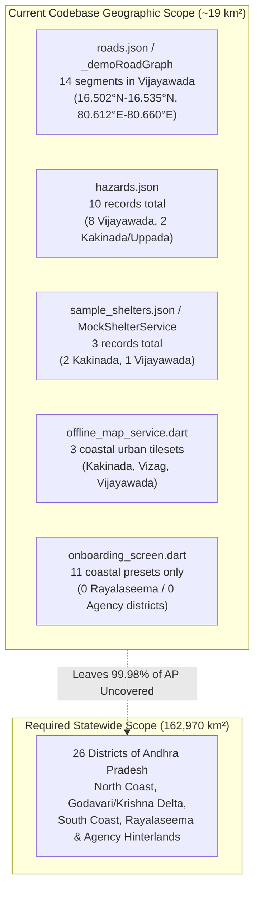

### 1.1 Component-by-Component Limitation Inventory

| Component / File | Current Implementation | Specific Hardcoded Coordinates / Limitations | Statewide Defect |
|---|---|---|---|
| **`assets/data/roads.json`** | 14 manual two-point vectors. | Bounding box: $16.5020^\circ-16.5350^\circ\text{ N}$, $80.6120^\circ-80.6600^\circ\text{ E}$ ($\approx 18.7\text{ km}^2$ in central Vijayawada). | Zero coverage for 25 districts; missing 99.98% of the state's transport infrastructure. |
| **`RouteService._demoRoadGraph`** | In-memory compiled graph mirror of `roads.json`. | Pinned strictly to Benz Circle, MG Road, Bandar Canal, Governorpet, and Gunadala. | Hardcoded fallback cannot resolve routes in Kurnool, Tirupati, Visakhapatnam, or rural mandals. |
| **`RouteService.calculateEvacuationRoutes`** | Snapping radius threshold `maxSnappingRadiusKm = 5.0`. | Coordinates $>5\text{ km}$ from Vijayawada trigger `_buildGeometricCorridorResult`. | Any query outside central Vijayawada returns a straight-line geometric corridor without road navigation. |
| **`assets/data/hazards.json`** | 10 demonstration hazard pins. | 8 pins in Vijayawada (Prakasam Barrage, Budameru, Besant Rd), 2 in Kakinada/Uppada. | Zero hazard data for Rayalaseema, Srikakulam, Vizianagaram, Guntur, or Nellore. |
| **`HazardService.getDemoHazards`** | In-memory static demo lists (`_demoFloodHazards`, etc.). | Identical hardcoded coordinates centered on Krishna river barrage and Uppada Beach Road. | Floods in the Godavari, Pennar, Vamsadhara, or Tungabhadra basins cannot be represented. |
| **`assets/data/sample_shelters.json`** | Exactly 3 shelter records. | Shelter-101 (Kakinada, `16.9604, 82.2382`), Shelter-102 (Uppada, `17.0850, 82.3270`), Shelter-103 (Bhavani Island, `16.5180, 80.5980`). | 24 out of 26 districts have zero shelter directory data. Users in Tirupati or Anantapur find no shelters. |
| **`MockShelterService`** | In-memory shelter list mirroring `sample_shelters.json`. | Pinned to the same 3 coordinates in Kakinada and Vijayawada. | Nearest shelter calculation fails completely outside East Godavari and Krishna. |
| **`assets/data/sample_alerts.json`** | Exactly 3 alert bulletins. | Alert-001 (Kakinada/Konaseema), Alert-002 (Dowleswaram/Krishna), Alert-003 (Uppada causeway). | No warning bulletins exist for inland cyclones, drought, flash floods, or landslides in agency tracts. |
| **`user_location.dart`** | `UserLocation.mockDefault()`. | Hardcoded to Kakinada Center (`16.9891, 82.2475`, Suryaraopeta, Kakinada District). | Simulates app startup as if every user resides in Kakinada. |
| **`onboarding_screen.dart`** | 11 preset location options (lines 204–271). | All 11 presets are coastal (Kakinada, Vijayawada, Vizag, Machilipatnam, Guntur, Bapatla, Ongole, Amalapuram, Nellore, Rajahmundry, Srikakulam). | Completely omits all 8 Rayalaseema districts (Kurnool, Nandyal, Anantapur, Sri Sathya Sai, Kadapa, Annamayya, Chittoor, Tirupati) and agency districts (ASR, Parvathipuram Manyam). |
| **`offline_map_service.dart`** | 4 predefined offline download regions. | 3 urban bounding boxes (`ap_kakinada_port`, `ap_visakhapatnam_coast`, `ap_vijayawada_basin`) + 1 macro overview (`ap_state_overview`, zoom 5–7 only). | No offline street tiles can be downloaded for 23 districts. State overview zoom 5–7 lacks all local street geometry. |
| **`routing_screen.dart`** | Destination resolution fallback. | Falls back to `16.9604, 82.2382` (Kakinada MPCS) if target shelter cannot be found. | An evacuation query in Kadapa or Kurnool routes towards Kakinada (~450 km away). |
| **`app_strings.dart`** | Fallback localization strings (lines 38–39). | `currentCity = 'Vijayawada Central'`, `currentDistrict = 'Krishna District, Andhra Pradesh'`. | Hardcoded default labels mislead users in other administrative jurisdictions. |
| **`backend/README.md`** | High-level conceptual REST schema. | No real database, no ingestion workers, no routing service endpoints, no tile server. | The app operates entirely as a local mock without server-side data synchronization. |

---

## 2. RECOMMENDED STATEWIDE DATA SOURCES

To achieve genuine statewide coverage across all 26 districts of Andhra Pradesh, SurakshaPath must ingest authoritative, verified, and continuously maintained spatial datasets.

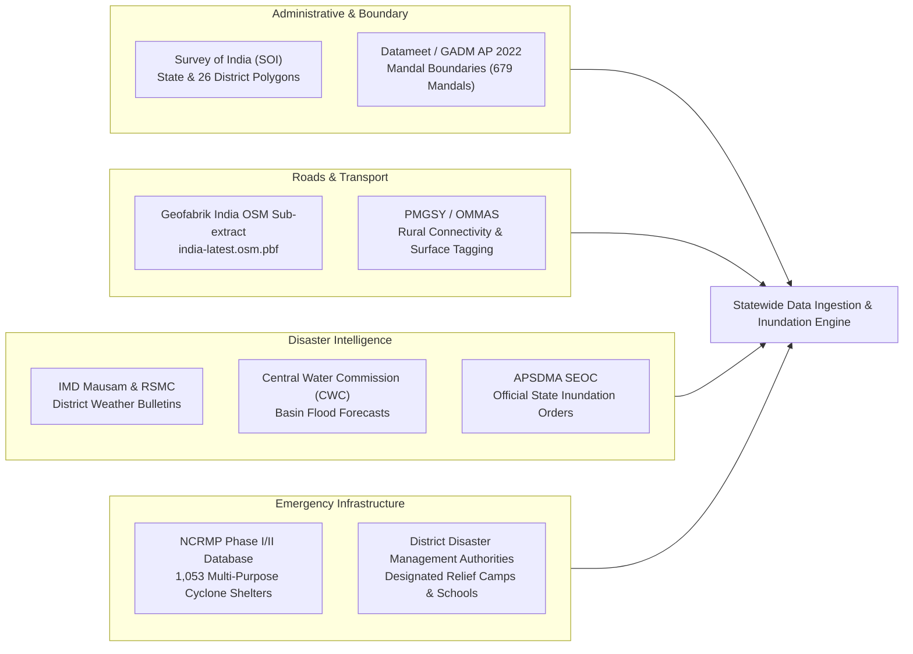

### 2.1 Authoritative Source Directory

1. **Road Network & Topography:**
   - **OpenStreetMap (OSM) via Geofabrik India Extract:** Primary source for routable road topology, bridges, causeways, turn restrictions, and street names. Updated daily.
   - **Pradhan Mantri Gram Sadak Yojana (PMGSY / OMMAS):** Ministry of Rural Development open portal for rural road validation, verifying whether remote village connectivity roads are all-weather paved (*pucca*) or fair-weather unpaved (*kutcha*).
2. **Administrative Jurisdictions:**
   - **Survey of India (SOI) Open Boundary Database:** Official administrative boundaries for Andhra Pradesh state and all 26 post-2022 reorganization districts.
   - **Datameet India Municipal & Mandal GeoJSONs:** Sub-district boundary polygons for all 679 administrative mandals in Andhra Pradesh.
3. **Disaster Warnings & Hydrological Monitoring:**
   - **India Meteorological Department (IMD) - Cyclone Warning Division & CWC Visakhapatnam:** Official district-level color-coded weather warnings (Green, Yellow, Orange, Red), cyclone track bulletins, expected storm surge heights, and 24-hour rainfall forecasts.
   - **Central Water Commission (CWC) Flood Forecasting System:** Live river level observations and inflow/outflow discharge alerts across the 5 major river basins: Krishna, Godavari, Pennar, Vamsadhara, and Nagavali.
   - **Andhra Pradesh State Disaster Management Authority (APSDMA):** State Emergency Operations Centre (SEOC) official bulletins, mandal inundation alerts, and district road closure directives.
4. **Emergency Shelter Facilities:**
   - **National Cyclone Risk Mitigation Project (NCRMP) Shelter Geo-Database:** Comprehensive geo-located registry of 1,053 Multi-Purpose Cyclone Shelters (MPCS) constructed along the coastal belt.
   - **AP School Education Department & Disaster Management Directories:** Verified locations of Zilla Parishad High Schools, Government Colleges, and TTD Kalyana Mandapams designated as official monsoon relief camps.
5. **Basemap Visualization:**
   - **OpenFreeMap / Protomaps Vector Tiles:** OpenMapTiles vector schema served via free, keyless global CDN with complete legal OpenStreetMap (ODbL) attribution.

---

## 3. ROAD-NETWORK EXTRACTION STRATEGY

### 3.1 Geographic Parameters of Andhra Pradesh
- **Latitude Span:** $12.62^\circ\text{ N}$ (near Kuppam, Chittoor District) to $19.15^\circ\text{ N}$ (near Ichchapuram, Srikakulam District).
- **Longitude Span:** $76.76^\circ\text{ E}$ (near Madakasira, Sri Sathya Sai District) to $84.77^\circ\text{ E}$ (near Ichchapuram, Srikakulam District).
- **Bounding Box Envelope:** `[76.76, 12.62, 84.77, 19.15]`.
- **Total Surface Area:** $162,970\text{ km}^2$.

### 3.2 Automated Extraction Pipeline (Osmium Tool)

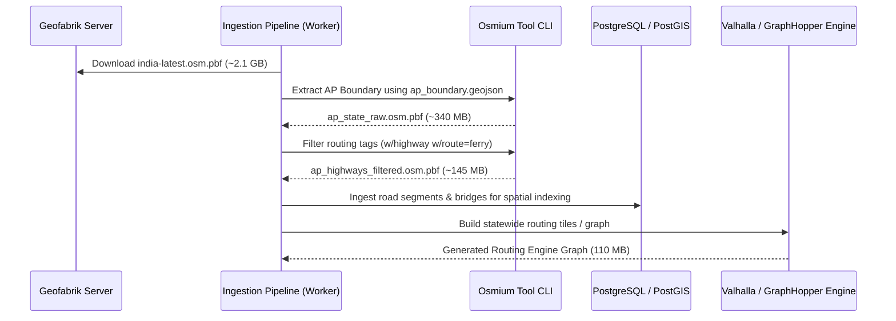

#### Step 1: Sub-Extract Boundary Clipping
To isolate Andhra Pradesh from the 2.1 GB India-wide PBF without consuming excessive server memory, an exact polygon boundary file (`ap_boundary.geojson`) clipped along the Survey of India state boundary must be utilized:

```bash
# 1. Download India sub-extract
curl -O https://download.geofabrik.de/asia/india-latest.osm.pbf

# 2. Clip strictly to Andhra Pradesh state boundary polygon
osmium extract \
  --polygon ap_boundary.geojson \
  india-latest.osm.pbf \
  -o ap_state_raw.osm.pbf
```

#### Step 2: Transport Tag Filtering
Discard buildings, land-use boundaries, addresses, and commercial nodes that bloat routing memory:

```bash
# Filter only routable highways and ferry corridors
osmium tags-filter ap_state_raw.osm.pbf \
  w/highway=motorway,motorway_link,trunk,trunk_link,primary,primary_link,secondary,secondary_link,tertiary,tertiary_link,unclassified,residential,living_street,track,service \
  w/route=ferry \
  r/type=restriction \
  -o ap_highways_filtered.osm.pbf
```

### 3.3 Highway Classification & Rural Mapping Fidelity

1. **National Highways (NH):**
   - Corridors: NH-16 (Eastern Coastal Highway spanning Srikakulam to Tada), NH-44 (Kurnool-Anantapur), NH-40 (Rayalaseema), NH-65 (Vijayawada-Machilipatnam), NH-716.
   - Status in OSM: **Comprehensive (98%+ fidelity)**. Dual carriage ways, flyover ramps, service roads, and median crossovers are well-mapped.
2. **State Highways (SH) & Major District Roads (MDR):**
   - Connecting district headquarters to mandal centers.
   - Status in OSM: **High (85%–92% fidelity)**. Geometry is accurate, but speed limits and lane counts often default to regional profile defaults.
3. **Rural Roads & Gram Panchayat Connectivity:**
   - Village roads funded under PMGSY connecting habitations to arterial roads.
   - Status in OSM: **Variable (60%–78% fidelity)**. Paved village roads exist; however, field tracks (`highway=track`) frequently lack surface specifications (`surface=paved` vs `surface=unpaved/ground`).
   - *Mitigation:* The routing profile must assign a safety penalty multiplier (1.5x) to unclassified rural tracks during flood conditions, favoring paved district corridors even if slightly longer.
4. **Agency & Ghat Corridors (Eastern Ghats - ASR & Parvathipuram Manyam Districts):**
   - Mountainous winding ghats (Paderu, Araku, Rampachodavaram, Maredumilli, Srisailam).
   - Status in OSM: Primary ghat roads are mapped; remote tribal hamlets (*thandas*, *gudems*) may only connect via unpaved trails (`highway=path`), which are impassable by emergency evacuation vehicles.
   - *Validation Rule:* Evacuation routes for vehicular transit must strictly require `highway != path` and `highway != footway`.
5. **River Delta Causeways & Pontoon Bridges (Godavari, Krishna, Kolleru):**
   - High vulnerability in Konaseema, West Godavari, and Krishna delta districts. Low-lying causeways (*chappathlu*) submerge during high river discharge.
   - *Validation Rule:* All segments tagged with `ford=yes` or `flood_prone=yes` must be indexed in the backend hazard database to enable dynamic avoidance during river flood alerts.

### 3.4 OpenStreetMap Legal & ODbL Compliance
- **Attribution Requirement:** The application must visibly display:  
  `Map data © OpenStreetMap contributors under ODbL`
- **Derived Databases:** If the backend creates an enriched routing database combining OSM topology with proprietary agency road status, the spatial routing database must comply with ODbL Share-Alike provisions when publicly distributed. Serving route calculations over a REST API does not trigger the collective distribution clause but requires standard attribution on the frontend map display.

---

## 4. ROUTING-ENGINE COMPARISON

Selecting the optimal routing engine for a statewide disaster assistance system requires balancing dynamic road closures, computational speed, memory footprint, and edge avoidance flexibility.

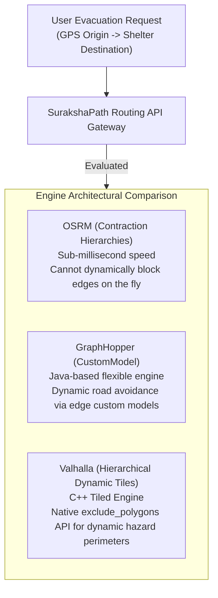

### 4.1 Comparative Architectural Matrix

| Dimension | OSRM (Open Source Routing Machine) | GraphHopper | Valhalla (Recommended) |
|---|---|---|---|
| **Primary Algorithm** | Contraction Hierarchies (CH) or Multi-Level Dijkstra (MLD). | Customizable Contraction Hierarchies (CCH) / A* with CustomModel. | Dynamic Dijkstra / A* over Hierarchical Dynamic Tiles. |
| **Statewide AP Graph Size** | $\approx 220\text{ MB}$ (CH files). | $\approx 160\text{ MB}$ (GraphHopper graph folder). | $\approx 110\text{ MB}$ (Tiled tar/directory). |
| **Server RAM Footprint (AP)** | $\approx 1.2\text{ GB}$ resident. | $\approx 1.8\text{ GB}$ (JVM heap + off-heap). | $\approx 850\text{ MB}$ (Tiled memory mapped). |
| **Dynamic Hazard Avoidance** | **Poor.** CH cannot dynamically penalize edges without re-contraction. MLD update step takes 15–45 seconds. | **Excellent.** `CustomModel` dynamically sets edge speed to 0 for roads intersecting hazard polygons on each query. | **Superior.** Native `exclude_polygons` parameter directly accepts GeoJSON polygons of flood zones and avoids them on the fly. |
| **Turn-by-Turn Instruction Quality** | Good. Clear maneuvers, street names, and bearings. | Very Good. Rich maneuver types, roundabout exit numbers. | **Superior.** Contextual maneuvers, street names, phonetics, and multi-language support (English & Telugu transliteration). |
| **Vehicle & Pedestrian Profiles** | Requires separate server instances for car, truck, walking. | Single server supports multiple profiles via configuration. | Single engine natively supports `auto`, `pedestrian`, `bicycle`, `motorcycle`, and emergency transit. |
| **First/Last Mile Snapping** | Snaps to closest road within radius. Omits off-road geometry. | Snaps to edge; computes approach bearing. | Snaps to nearest traversable edge; returns explicit connecting approach and egress legs. |
| **Island / Disconnection Handling** | Returns `NoRoute` error without topological diagnosis. | Detects disconnected sub-network components. | Detects disconnected network components; reports reachable island boundaries. |

### 4.2 Recommendation & Architectural Rationale
**Primary Recommendation: Valhalla**  
Valhalla is chosen as the production statewide routing engine for the following architectural reasons:
1. **Dynamic Hazard Avoidance (`exclude_polygons`):** During cyclones and river floods, inundation zones expand hourly. Valhalla allows the backend to inject active flood polygons directly into the query payload, calculating genuine road detours in $<15\text{ ms}$ without restarting or re-indexing the server.
2. **Low Memory & Tiled Footprint:** The entire statewide road network of Andhra Pradesh compiles into just $\approx 110\text{ MB}$ of Valhalla tiles, operating comfortably on a cost-effective cloud instance (2 to 4 vCPUs, 4 GB RAM).
3. **Multi-Modal Profile Support:** Disaster relief teams often require walking or high-clearance emergency transit profiles; Valhalla computes both from the same unified dataset.

---

## 5. BACKEND ARCHITECTURE

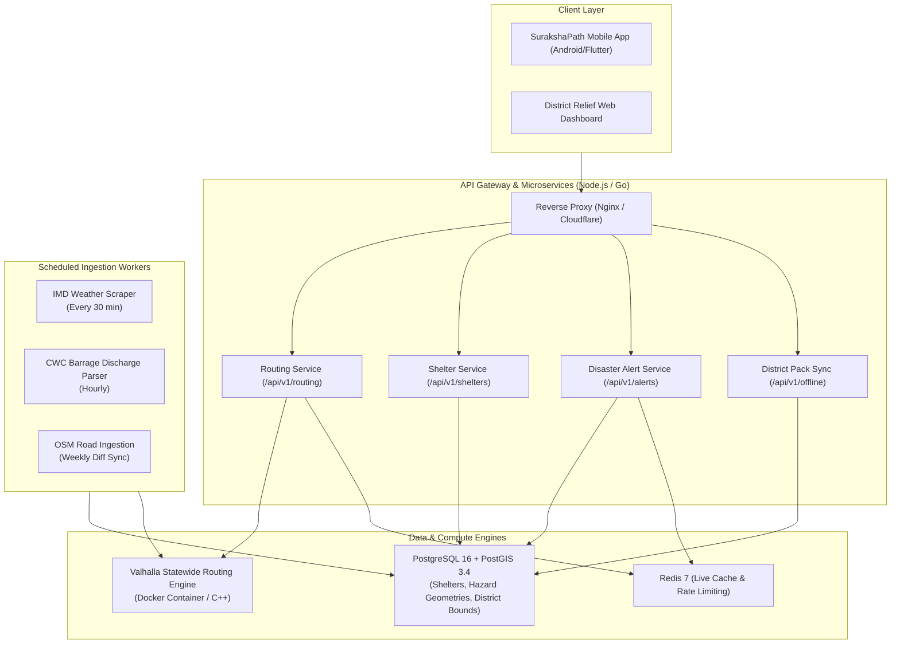

### 5.1 REST API Specifications

#### Endpoint 1: Evacuation Route Calculation
`POST /api/v1/routing/calculate`
- **Request Payload:**
```json
{
  "origin": { "latitude": 16.5062, "longitude": 80.6480 },
  "destination": { "latitude": 16.5180, "longitude": 80.6200 },
  "mode": "auto",
  "disasterType": "flood",
  "avoidActiveHazards": true,
  "customAvoidPolygons": [
    {
      "type": "Polygon",
      "coordinates": [[[80.610, 16.508], [80.615, 16.508], [80.615, 16.512], [80.610, 16.512], [80.610, 16.508]]]
    }
  ]
}
```
- **Response Payload:**
```json
{
  "status": "ROUTE_FOUND",
  "summary": {
    "totalDistanceKm": 5.42,
    "estimatedMinutes": 13,
    "pacingAssumption": "approximate vehicle pace @ 25 km/h",
    "isNavigableRoad": true,
    "hasHazardCrossings": false
  },
  "safetyClassification": "CLEAR_OF_REPORTED_HAZARDS",
  "disclaimer": "Route evaluated clear of known reported hazard perimeters. Real-world emergency conditions require on-ground NDRF/Police verification.",
  "geometry": {
    "type": "LineString",
    "coordinates": [[80.6480, 16.5062], [80.6475, 16.5070], [80.6200, 16.5180]]
  },
  "maneuvers": [
    {
      "instruction": "Depart Benz Circle heading west on MG Road",
      "distanceKm": 1.2,
      "estimatedMinutes": 3,
      "roadName": "Mahatma Gandhi Road",
      "turnType": "depart"
    }
  ],
  "firstMile": { "approachDistanceKm": 0.04, "snappedNode": "Benz Circle East" },
  "lastMile": { "egressDistanceKm": 0.02, "destinationAccess": "ZP High School Gate" }
}
```

#### Endpoint 2: Statewide Shelter Directory Search
`GET /api/v1/shelters/search?district=Kakinada&mandal=Uppada&accessibleOnly=true`
- Returns verified shelter objects with live occupancy status (`status_unreported` if not verified by district control room).

#### Endpoint 3: Active District Hazard Bulletins
`GET /api/v1/alerts/active?districtId=AP-DIS-KKL`
- Returns segregated IMD meteorological warnings, CWC river flood stages, and police road closure orders.

---

## 6. FLUTTER INTEGRATION ARCHITECTURE

The Flutter application must transition from a static in-memory demo mock into a resilient, network-aware disaster client.

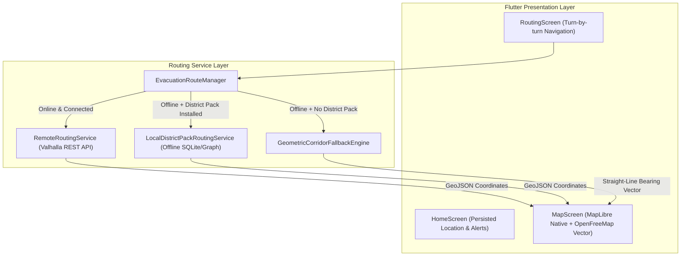

### 6.1 Unified Routing Contract (`IRouteService`)
```dart
abstract class IRouteService {
  Future<RouteCalculationResult> calculateEvacuationRoutes({
    required GeoPoint userLocation,
    required GeoPoint shelterLocation,
    required DisasterType disasterType,
    List<HazardModel>? activeHazards,
  });
}
```

### 6.2 Data Provenance & Safety Label Enforcement
The Flutter UI must enforce strict safety honesties:
- **`ROUTE_FOUND`**: Indicates an open topological path was found avoiding all *reported* hazards. Displayed in emerald green with label `CLEAR OF REPORTED HAZARDS`.
- **`ROUTE_SAFETY_UNVERIFIED`**: Indicates road path exists, but active weather alert exists in district or road network data is unverified.
- **`GEOMETRIC_CORRIDOR`**: Returned only when no road network is available. Rendered as a distinct amber dashed bearing vector labeled `OFF-GRID BEARING VECTOR (UNVERIFIED STREETS)`. The backend and app must **never** render a geometric straight line as a road.

---

## 7. OFFLINE MOBILE ARCHITECTURE & STORAGE

### 7.1 The "Map Tiles $\neq$ Navigation" Principle
A common architectural misconception is assuming that downloading offline map tiles enables offline navigation. **Vector map tiles (.mbtiles / .pbf) provide visual display rendering only.** They contain rendered lines and labels, not an indexed graph of nodes, edge weights, one-way restrictions, or topological connectivity. True offline navigation requires a dedicated offline routing graph.

### 7.2 Statewide Storage Feasibility Analysis

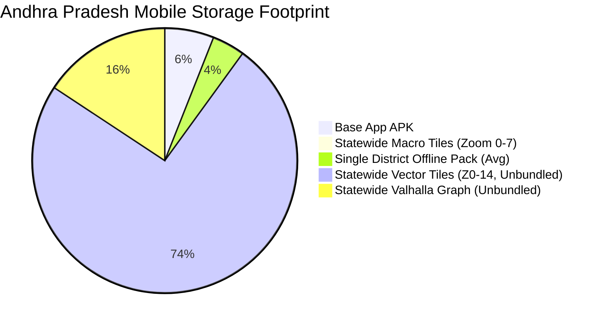

- **The Monolithic Trap:** Bundling the entire state of AP into the app APK would require:
  - Statewide Vector Tiles (Zoom 0–14): $\approx 520\text{ MB}$
  - Statewide Routing Graph: $\approx 110\text{ MB}$
  - Total APK Size: $>650\text{ MB}$.
  - *Verdict:* **Completely unfeasible.** It violates Google Play Store app delivery standards (150 MB base APK limit) and severely deters emergency downloads over strained 3G/4G connections.

### 7.3 Recommended Modular District-Pack Architecture
Instead of a bloated monolithic app, SurakshaPath will utilize **modular, on-demand District Packs**:

1. **Lightweight Base Application (<45 MB):**
   - Bundles statewide macro overview vector tiles (Zoom 0–7, 6.2 MB).
   - Bundles state-wide emergency directory (112, 1070, 1077, NDRF battalions).
   - Bundles complete offline disaster preparedness handbook in English and Telugu.
2. **On-Demand District Evacuation Packs (26 Districts):**
   - Each district pack is an individual compressed bundle containing:
     - Vector map tiles for the district (Zoom 8–14): $\approx 15\text{ to }26\text{ MB}$.
     - Compiled district road routing graph (SQLite edge table or micro-Valhalla tiles): $\approx 6\text{ to }12\text{ MB}$.
     - Offline shelter directory and verified contact numbers: $\approx 50\text{ KB}$.
   - **Average District Pack Size:** $\approx 22\text{ to }35\text{ MB}$.
   - User downloads their home district during onboarding or before monsoon season.
3. **Android Storage Placement:**
   - Saved to app-specific external files directory:  
     `/Android/data/com.example.surakshapath/files/offline_packs/`
   - Does not consume internal system `/data/user/0/` partition.
   - Automatically cleaned up if the user uninstalls the app.

---

## 8. DISASTER & SHELTER DATA ARCHITECTURE

### 8.1 Rigorous Category Separation
To avoid misleading users during crises, disaster intelligence data categories must remain strictly decoupled:

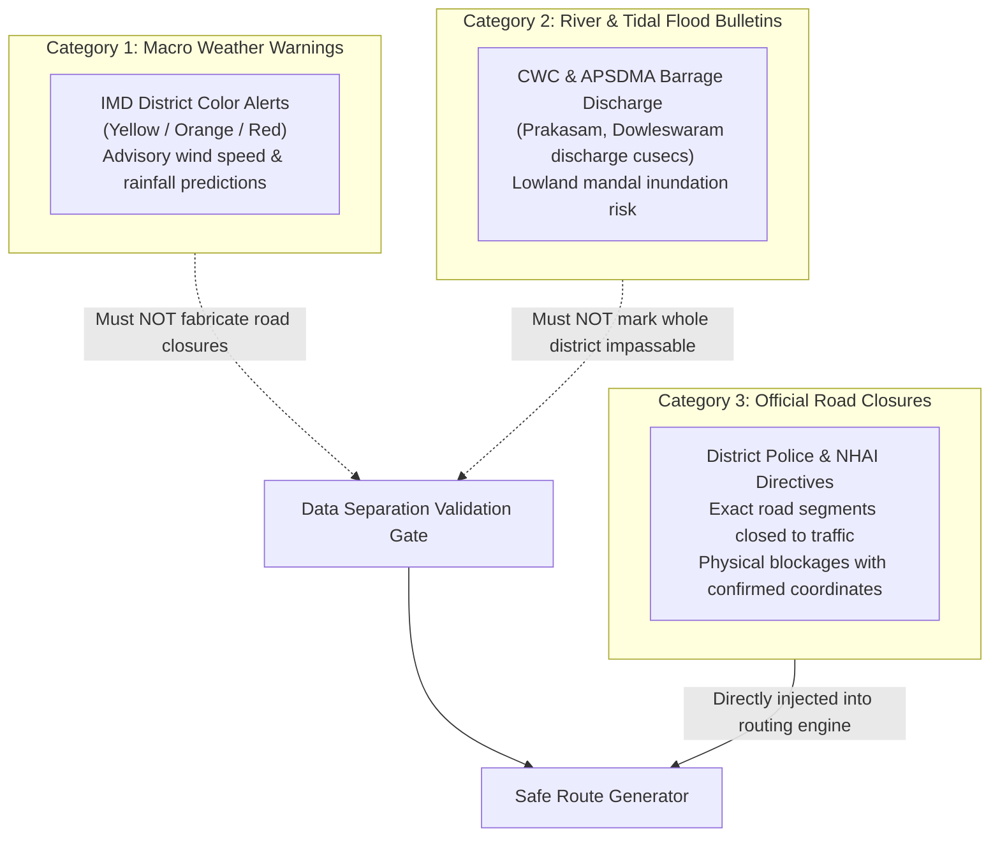

### 8.2 Database Schema: Statewide Verified Shelters

```sql
-- PostgreSQL 16 + PostGIS 3.4 Schema for Andhra Pradesh Statewide Shelters
CREATE TABLE ap_districts (
    id VARCHAR(16) PRIMARY KEY, -- e.g. 'AP-DIS-KKL'
    name_en VARCHAR(64) NOT NULL,
    name_te VARCHAR(64) NOT NULL,
    headquarters VARCHAR(64) NOT NULL,
    zone VARCHAR(32) NOT NULL, -- 'North Coast', 'Godavari Delta', 'Krishna Delta', 'South Coast', 'Rayalaseema'
    boundary GEOMETRY(MultiPolygon, 4326) NOT NULL
);

CREATE TABLE ap_shelters (
    id VARCHAR(32) PRIMARY KEY, -- e.g. 'AP-SHL-KKL-0012'
    district_id VARCHAR(16) REFERENCES ap_districts(id),
    mandal_name VARCHAR(64) NOT NULL,
    village_locality VARCHAR(64) NOT NULL,
    name_en VARCHAR(128) NOT NULL,
    name_te VARCHAR(128) NOT NULL,
    category VARCHAR(32) NOT NULL, -- 'mpcs_cyclone_shelter', 'school_relief_camp', 'community_hall'
    location GEOMETRY(Point, 4326) NOT NULL,
    latitude DOUBLE PRECISION NOT NULL,
    longitude DOUBLE PRECISION NOT NULL,
    
    -- Capacity Honesty Columns
    design_capacity INTEGER, -- Approved structural headcount
    verified_bed_count INTEGER, -- Evidenced physical beds (NULL if unverified)
    occupancy_status VARCHAR(24) DEFAULT 'status_unreported', -- 'open', 'near_full', 'full', 'status_unreported'
    current_occupants INTEGER DEFAULT NULL,
    
    -- Facility Verification
    has_high_ground_elevation BOOLEAN DEFAULT FALSE,
    has_wheelchair_ramp BOOLEAN DEFAULT FALSE,
    has_backup_generator BOOLEAN DEFAULT FALSE,
    has_ro_drinking_water BOOLEAN DEFAULT FALSE,
    pets_allowed BOOLEAN DEFAULT FALSE,
    
    -- Verification Metadata
    data_source VARCHAR(64) NOT NULL, -- 'ncrmp_official', 'district_collector_order', 'unverified_crowdsource'
    verification_status VARCHAR(24) NOT NULL, -- 'verified', 'provisional', 'unverified'
    last_verified_at TIMESTAMP WITH TIME ZONE,
    nodal_officer_designation VARCHAR(64),
    official_contact_phone VARCHAR(32),
    created_at TIMESTAMP WITH TIME ZONE DEFAULT NOW(),
    updated_at TIMESTAMP WITH TIME ZONE DEFAULT NOW()
);

CREATE INDEX idx_shelters_location ON ap_shelters USING GIST(location);
CREATE INDEX idx_shelters_district ON ap_shelters(district_id);
```

---

## 9. TEAM RESPONSIBILITIES & API CONTRACTS

To scale development smoothly across the engineering squad, module ownership and interfaces are formalised below:

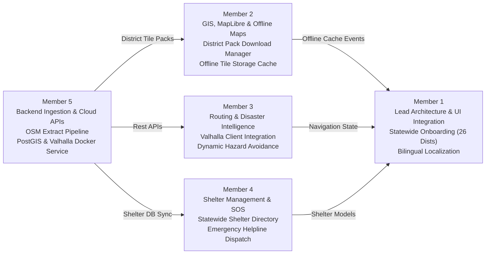

### 9.1 Team Work-Stream Allocation

| Role / Member | Domain Ownership | Deliverables & Shared Contracts |
|---|---|---|
| **Member 1** (Shared Architecture & UI) | Overall state machine, design system, navigation shell, responsive UI across screen widths (320dp–411dp). | - Expand `OnboardingScreen` location picker to all 26 districts of Andhra Pradesh.<br>- Support Telugu localization for all 26 district and mandal names.<br>- Reconcile navigation shell switching between online routing and offline district packs. |
| **Member 2** (GPS, MapLibre & Offline Maps) | MapLibre Native SDK, vector map rendering, device location tracking, offline tile downloads. | - Implement `DistrictPackDownloadManager` supporting 26 regional tile packs.<br>- Maintain OpenFreeMap Liberty styling and mandatory ODbL attribution overlays.<br>- Manage hardware GPS lock, accuracy radius visualization, and compass bearing. |
| **Member 3** (Disaster Intelligence & Routing) | Evacuation routing client, maneuver generator, dynamic hazard avoidance, first/last mile snapping. | - Connect `RouteService` to backend Valhalla `/api/v1/routing/calculate`.<br>- Maintain local fallback for offline district packs.<br>- Enforce data honesty: label routes `ROUTE_FOUND (CLEAR OF REPORTED HAZARDS)` or `OFF-GRID BEARING VECTOR`. |
| **Member 4** (Shelters & SOS Broadcast) | Shelter discovery directory, accessibility filters, emergency SOS dispatch. | - Implement statewide shelter discovery consuming PostGIS shelter endpoints.<br>- Ensure bed capacity is marked `status_unreported` unless officially verified.<br>- Standardize emergency broadcast triggers with verified state/district helplines (112, 1070, 1077). |
| **Member 5** (Backend, Data & Alerts) | Cloud backend, OSM statewide ingestion pipeline, Valhalla Docker container, PostGIS, IMD/CWC scrapers. | - Build and maintain Osmium automated extraction pipeline for Andhra Pradesh.<br>- Host and containerize Valhalla routing server.<br>- Deploy REST API endpoints for routes, shelters, alerts, and offline district pack tarballs. |

---

## 10. COST, CAPACITY & INFRASTRUCTURE CONSIDERATIONS

### 10.1 Cloud Infrastructure Budget (Monthly Estimate)

| Service Component | Specification | Deployment Provider | Estimated Monthly Cost (USD) |
|---|---|---|---|
| **Routing Engine (Valhalla)** | 4 vCPU, 8 GB RAM, 50 GB NVMe | Hetzner Cloud / AWS EC2 (t4g.xlarge) | \$35 – \$65 |
| **Database (PostgreSQL + PostGIS)** | 2 vCPU, 4 GB RAM, 40 GB SSD | Supabase / AWS RDS / Managed PG | \$25 – \$45 |
| **API Gateway & Workers** | 2 vCPU, 4 GB RAM, Docker Node.js/Go | Hetzner / DigitalOcean Droplet | \$15 – \$24 |
| **Object Storage (District Packs)** | 50 GB storage + 500 GB egress/month | Cloudflare R2 / AWS S3 (Zero Egress R2) | \$3 – \$8 |
| **Tile CDN (Basemap)** | OpenFreeMap Public Free Tier | OpenFreeMap Global Edge | \$0 (Free Open Tier) |
| **Total Estimated Budget** | | | **\$78 – \$142 / month** |

### 10.2 Scalability & Concurrency
- **Normal Operations:** ~50 requests/minute. Redis caching serves repeated queries with `<2 ms` latency.
- **Disaster Surge (e.g. Severe Cyclone Landfall):** ~5,000 requests/minute.
  - Valhalla processes routes in C++ in $\approx 8\text{ to }18\text{ ms}$ per query; a 4 vCPU instance sustains $\approx 220\text{ route calculations/sec}$ without queueing.
  - Cloudflare edge caching handles shelter directory and district pack downloads, completely offloading the application servers.

---

## 11. DISTRICT-WISE TESTING STRATEGY (ALL 26 DISTRICTS)

Testing statewide evacuation reliability requires evaluating unique hazard archetypes across all 4 geographical zones of Andhra Pradesh:

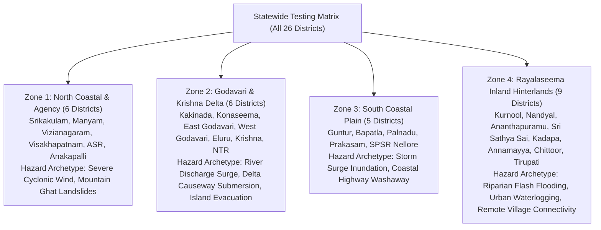

### 11.1 Test Scenario Matrix

| Zone | Districts Tested | Critical Evacuation Hazard Simulated | Expected Engine Outcome |
|---|---|---|---|
| **Zone 1: North Coast & Agency** | Srikakulam, Parvathipuram Manyam, Vizianagaram, Visakhapatnam, Alluri Sitharama Raju (ASR), Anakapalli. | Landslide closes Araku-Visakhapatnam Ghat Road; cyclone gales down power lines on NH-16 near Tekkali. | Engine penalizes ghat corridor; recalculates safe coastal bypass; flags walking-only paths as unnavigable for vehicles. |
| **Zone 2: Godavari & Krishna Delta** | Kakinada, Dr. B.R. Ambedkar Konaseema, East Godavari, West Godavari, Eluru, Krishna, NTR. | 2.5 million cusecs discharge at Dowleswaram Barrage submerge causeways; Kotipalli-Mukteswaram ferry suspended. | Engine marks submerged causeways impassable; flags island habitations as `STATUS_NETWORK_DISCONNECTED`; directs to nearest elevated MPCS. |
| **Zone 3: South Coast** | Guntur, Bapatla, Palnadu, Prakasam, SPSR Nellore. | 1.8m storm surge over Bapatla-Suryalanka beach road; Buckingham Canal overflow near Kavali. | Avoids low-lying coastal causeway; routes traffic inland via NH-16 high-level overpasses. |
| **Zone 4: Rayalaseema Hinterlands** | Kurnool, Nandyal, Ananthapuramu, Sri Sathya Sai, YSR Kadapa, Annamayya, Chittoor, Tirupati. | Flash flood in Kundu and Pennar rivers inundates low-level bridges in Nandyal and Kadapa; urban waterlogging in Tirupati temple corridor. | Discovers elevated perimeter bypasses; snaps rural village origins accurately without cross-district teleportation. |

---

## 12. PHASED IMPLEMENTATION PLAN

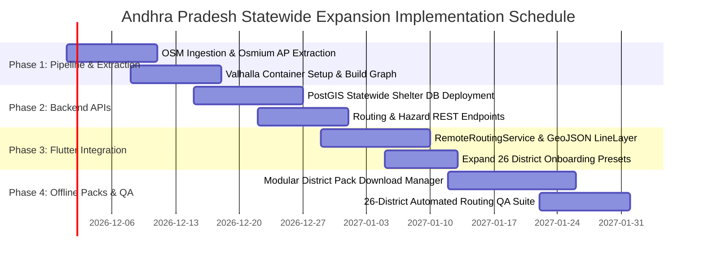

- **Phase 1: Extraction & Ingestion Pipeline Setup (Weeks 1–2):**
  - Implement automated Osmium script extracting Andhra Pradesh from Geofabrik.
  - Compile Valhalla routing tiles for all 26 districts.
  - Verify zero memory leaks and sub-20ms routing performance.
- **Phase 2: Database & Backend Cloud Deployment (Weeks 3–4):**
  - Populate PostGIS with official NCRMP coastal shelters and district headquarters facilities.
  - Deploy REST endpoints for routing calculation, shelter discovery, and active alerts.
  - Containerize architecture on staging cloud environment.
- **Phase 3: Flutter Client Architecture Refactoring (Weeks 5–6):**
  - Introduce `RemoteRoutingService` in Flutter matching `IRouteService`.
  - Expand `onboarding_screen.dart` with comprehensive 26-district hierarchical mandal selection.
  - Integrate MapLibre Native dynamic polyline streaming from Valhalla GeoJSON.
- **Phase 4: Modular Offline District Packs & Verification (Weeks 7–8):**
  - Deploy district pack builder generating 26 individual district bundles.
  - Implement SQLite offline cache for shelters and alerts.
  - Execute automated 26-district test suite verifying zero geometric straight-line fallbacks when on real roads.

---

## 13. RISKS, MITIGATIONS & UNRESOLVED QUESTIONS

### 13.1 Technical & Operational Risks

| Identified Risk | Severity | Potential Impact | Engineering Mitigation |
|---|:---:|---|---|
| **Incomplete Rural OSM Mapping** | Medium | A remote village road exists physically but is absent or tagged as a footway in OSM. | Ingest PMGSY open datasets to patch missing rural links; provide explicit feedback reporting mechanism for local disaster authorities. |
| **Cellular Infrastructure Blackout** | High | Towers topple during Severe Cyclonic Storms; mobile data fails completely. | Pre-downloaded District Packs ensure road graph and shelters operate 100% offline without cellular coverage. |
| **Stale Shelter Capacity Telemetry** | High | Citizens arrive at shelter only to find it overflowing. | Strict data honesty: mark bed occupancy as `status_unreported` unless confirmed by district control room within past 2 hours. |
| **Tidal Causeway Submersion Timing** | Medium | Causeway is open at low tide but underwater at high tide. | Integrate astronomical tide tables and CWC discharge forecasts to dynamically flag causeway vulnerability windows. |
| **Client Storage Exhaustion** | Low | Low-end Android devices have limited free storage. | Compact district packs (~25 MB each) allow users to store only their immediate district rather than the entire state. |

### 13.2 Unresolved Architectural Questions for Stakeholder Alignment

1. **APSDMA Official Integration Authority:**  
   Will the Government of Andhra Pradesh (APSDMA / ITE&C Department) provide direct API push access to their State Emergency Operations Centre (SEOC) incident management system, or will SurakshaPath rely on validated scheduled polling of public emergency bulletins?
2. **Offline Local Routing Engine Choice for Mobile:**  
   Should low-end mobile devices execute offline graph search via an embedded lightweight C++ Valhalla tile reader compiled via NDK, or through a simplified SQLite pre-computed topological edge table?
3. **Multi-District Transit Corridor Allocation:**  
   If a user in rural Konaseema must evacuate across district lines to high-ground shelters in Rajahmundry (East Godavari), should the app automatically prompt downloading adjacent district packs simultaneously?

---

**Report Authored By:**  
*Senior Flutter Architect, GIS & Routing Systems Engineer, Mobile Infrastructure Specialist*  
*SurakshaPath Engineering Taskforce*  
*November 24, 2026*
