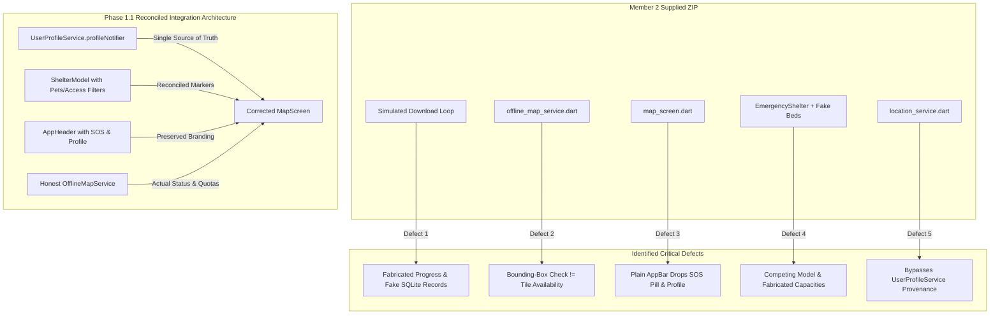

# SURAKSHAPATH: MEMBER 2 OFFLINE MAP & GPS MODULE PRE-INTEGRATION AUDIT

> **Project Root:** `C:\Users\pinni\.gemini\antigravity\scratch\surakshapath`  
> **Source Module:** `C:\Users\pinni\Downloads\SurakshaPath_OfflineMap_GPS_Module.zip`  
> **Baseline Checkpoint:** Commit `3c96fc39ca5a934fa1e665cdbe427e85ae475d19` (Phase 1.1 Verified)  
> **Auditor:** Senior Flutter Architect, GIS Engineer & Release QA Engineer  
> **Date:** November 23, 2026  
> **Status:** **PRE-INTEGRATION AUDIT COMPLETE — CRITICAL DEFECTS IDENTIFIED**

---

## 1. Executive Summary

This audit assesses the supplied **Member 2: Offline Maps & GPS Module** (`SurakshaPath_OfflineMap_GPS_Module.zip`) against the verified **SurakshaPath Phase 1.1** codebase. The module introduces MapLibre Native vector rendering, OpenFreeMap Liberty style integration, hardware GNSS acquisition, SQLite storage, and offline region download management.

While the module demonstrates strong GIS fundamentals (Web Mercator tile estimators, OpenFreeMap 3,000-tile quota guards, and direct satellite receiver integration), **critical architectural and honesty defects were discovered** that prohibit direct file copying:
1. **Fabricated Offline Download Progress:** When native MapLibre offline downloads fail or are executed in test environments, `OfflineMapService._simulateDownloadAndRecord` runs a simulated loop from 20% to 100% and writes an unverified success record to SQLite.
2. **Geographical Coverage vs. Tile Availability Conflation:** `isLocationInsideDownloadedRegion()` checks only whether coordinates fall within a bounding box, falsely claiming offline availability even when zero tiles were downloaded.
3. **Connectivity vs. Tile Availability Conflation:** The map screen displays `Online (OpenFreeMap Live)` purely on internet reachability, ignoring whether tile requests succeed or return HTTP 429/500 errors.
4. **Competing Shelter Model with Fabricated Capacities:** Member 2 introduced an independent `EmergencyShelter` class with SQLite seeding containing exact fabricated bed counts (`capacity: 650`, `900`, `450`, `800`) and fake contact numbers (`+91-866-2420000 (Demo)`), conflicting with the project's single source of truth (`ShelterModel` in `lib/core/models/shelter_model.dart`).
5. **GPS Profile Disconnection:** Member 2's `LocationService` operates independently of `UserProfileService.profileNotifier`, ignoring the user's persisted location and provenance (`LIVE GPS FIX`, `MANUALLY SELECTED`, `DEMO LOCATION`).
6. **Design System & Navigation Disruption:** Member 2 replaced the persistent `AppHeader` (which houses the critical Red SOS Pill, Profile Avatar, and Language Switcher) with a plain `AppBar`, violating Rule 9 and breaking cross-screen navigation consistency.



---

## 2. File Inventory & Disposition

### 2.1. Files to Integrate (After Corrections)
| Member 2 File | Proposed Main Project Path | Purpose |
| :--- | :--- | :--- |
| `lib/features/map/offline_map_service.dart` | `lib/features/map/services/offline_map_service.dart` | MapLibre offline tile manager, tile quota estimator, and offline region SQLite manager. |
| `lib/features/map/map_screen.dart` | `lib/features/map/screens/map_screen.dart` | Replaces mock canvas with real MapLibre Native map, vector styling, and offline controls. |
| `test/features/map/offline_map_service_test.dart` | `test/offline_map_service_test.dart` | Unit tests for tile estimators, quota limits, and region definitions. |

### 2.2. Files Requiring Major Correction Before Integration
1. **`lib/features/map/offline_map_service.dart`:**
   - **Remove:** `_simulateDownloadAndRecord()` method entirely.
   - **Correct:** `downloadRegion()` must emit an explicit error state on failure, cancel, or timeout, and must **never** write a success record to `downloaded_regions` unless confirmed by the native engine.
   - **Correct:** `isLocationInsideDownloadedRegion()` must be renamed/documented as checking geographical bounding box coverage only, and paired with a clear disclaimer: `Offline map availability not verified` unless verified on physical device.
   - **Reconcile:** Replace `EmergencyShelter` with the shared `ShelterModel`. Remove fabricated capacity fields (`650`, `900`, etc.) and fake phone numbers. SQLite should store and cache real/demo `ShelterModel` records.
2. **`lib/features/map/map_screen.dart`:**
   - **Restore:** Persistent `AppHeader` (SOS pill, profile avatar, language switch) instead of plain `AppBar`.
   - **Integrate:** Initialize map camera centered on `UserProfileService.currentLocation` rather than hardcoded AP center.
   - **Synchronize:** GPS button must update `UserProfileService.updateLocation()` with `LocationProvenance.liveGps` and real accuracy.
   - **Correct:** Replace `Online (OpenFreeMap Live)` with honest status: `Network Available (OpenFreeMap)` or `Offline Mode`.
   - **Design System:** Use `AppColors`, `AppDimensions`, `AppIcons`, and `AppStrings`.
3. **`lib/features/map/location_service.dart`:**
   - Do **not** duplicate `class LocationService`. The main project already possesses `DeviceLocationService` in `lib/core/services/location_service.dart`.
   - If Member 2's `LocationResult` error classifications (`LocationErrorType`) add value, integrate them into `lib/core/services/location_service.dart` without breaking existing `ILocationService` or `IDeviceLocationService` contracts.

### 2.3. Existing Files That Must Remain Strictly Untouched
- `lib/features/disaster/**` (Member 3 - Disaster Alerts)
- `lib/features/routing/**` (Member 3 - Evacuation Routing)
- `lib/features/shelters/**` (Member 4 - Shelters Discovery & Filters)
- `lib/features/emergency/**` (Member 4 - Emergency SOS & Dialer)
- `assets/data/**` (Member 5 - Sample Alerts & Shelters JSON)
- `backend/**` (Member 5 - Backend Services)
- `lib/navigation/main_navigation_shell.dart` (Five-tab navigation shell)

---

## 3. Dependency Conflicts & Version Matrix

| Dependency | Main Project (`pubspec.yaml`) | Member 2 (`pubspec.yaml`) | Reconciliation Strategy |
| :--- | :--- | :--- | :--- |
| `name` | `surakshapath` | `suraksha_path` | **PRESERVE `surakshapath`**. Member 2's name change must be rejected. |
| `geolocator` | `^14.1.2` | `^13.0.0` | **PRESERVE `^14.1.2`**. Main project has resolved modern geolocator; downgrading would cause regressions. |
| `maplibre` | *Not present* | `^0.4.0` | **ADD `maplibre: ^0.4.0`**. Required for vector rendering. |
| `sqflite` | *Not present* | `^2.3.3+1` | **ADD `sqflite: ^2.4.6`**. Required for local offline database. |
| `path` | *Not present* | `^1.9.0` | **ADD `path: ^1.9.0`**. Required for database path joins. |
| `path_provider` | *Not present* | `^2.1.5` | **ADD `path_provider: ^2.1.5`**. Required for application documents directory resolution. |
| `connectivity_plus` | *Not present* | `^6.1.0` | **ADD `connectivity_plus: ^6.1.5`**. Required for network status monitoring. |
| `permission_handler`| *Not present* | `^11.3.0` | **ADD `permission_handler: ^11.4.0`**. Required for advanced Android runtime permissions. |

---

## 4. Shared Model Conflicts: Shelter Reconciliation

Member 2 created a redundant `EmergencyShelter` class that conflicts with `ShelterModel`:

```dart
// Member 2 redundant class (Contains fabricated exact values):
class EmergencyShelter {
  final int capacity;        // Fabricated (e.g., 650, 900)
  final String contactNumber;// Fabricated (e.g., +91-866-2420000 (Demo))
  ...
}

// Main Project Single Source of Truth (lib/core/models/shelter_model.dart):
class ShelterModel {
  final String id;
  final String name;
  final double latitude;
  final double longitude;
  final String address;
  final int? capacity;       // Nullable! Not fabricated
  final int? currentOccupancy;// Nullable! Not fabricated
  final bool isVerified;     // false for all demo data
  final List<String> facilities; // Contains 'Wheelchair Accessible', 'Pets Allowed'
  ...
}
```

**Reconciliation Requirements:**
1. Eliminate `EmergencyShelter`. Map all shelter markers on the MapLibre map directly to `ShelterModel`.
2. Adapt SQLite table `shelters` to store serialized `ShelterModel` JSON or columns matching `ShelterModel`.
3. Support the Phase 1.1 `Pets Allowed` and `Accessible` filters so shelter markers on the map reflect active filters.
4. Keep all capacity figures honest (displayed as unverified or unknown unless officially sourced).

---

## 5. Location Synchronization & Provenance Risks

1. **Independent State Risk:** Member 2's `MapScreen` stored position in local state `_currentPosition` without syncing with `UserProfileService`. If a user acquired GPS on Home, Map would not know; if user acquired GPS on Map, Home would not update.
   - **Fix:** MapScreen must read `UserProfileService.currentLocation` and subscribe to `UserProfileService.profileNotifier`. Tapping the GPS recenter button must invoke `UserProfileService.updateLocation(...)`.
2. **Default Coordinate Overwrite:** Member 2's `MapScreen` centered on `apCenterLat` (15.9129, 79.7400) by default.
   - **Fix:** Initial camera must center on `UserProfileService.currentLocation` (whether live GPS, manual selection, or demo baseline).
3. **Provenance Integrity:** The location pin on the map must visually indicate whether it represents a `LIVE GPS FIX`, `MANUALLY SELECTED`, or `DEMO LOCATION`.

---

## 6. Offline-Map Reliability & Honesty Risks

1. **Fake Download Loop in `offline_map_service.dart`:**
   Lines 643-686 of Member 2's code catch native FFI errors and run `_simulateDownloadAndRecord`, creating fake progress and writing unverified records to SQLite.
   - **Correction:** Remove this simulation completely. If native download fails, emit `DownloadProgressStatus` with `error: e.toString()` and `isCompleted: false`. Never insert into `downloaded_regions`.
2. **Bounding-Box Limitation:**
   MapLibre Native manages offline tile packages in its internal SQLite cache. The app's `downloaded_regions` table only records the bounding box of requested downloads.
   - **Correction:** The UI must state: `Bounding Box Coverage Downloaded (Actual tile availability unverified until physical device offline test)`.
3. **OpenFreeMap Quota Guard:**
   Member 2's implementation of Web Mercator tile count estimation (`estimateTileCount`) and 3,000-tile quota guard is mathematically sound and adheres strictly to OpenFreeMap terms. It will be preserved and tested.

---

## 7. Android Configuration Requirements

1. **`minSdkVersion`:**
   MapLibre Native Android binary packages require `minSdkVersion 24` (Android 7.0).
   In `android/app/build.gradle.kts`:
   ```kotlin
   defaultConfig {
       minSdk = 24 // Updated from flutter.minSdkVersion (21)
       ...
   }
   ```
2. **`AndroidManifest.xml`:**
   Add `<uses-permission android:name="android.permission.ACCESS_NETWORK_STATE" />` for `connectivity_plus`.
   Preserve application package `com.example.surakshapath`, application label `surakshapath`, and intent filters.

---

## 8. Testing Gaps & Required Test Matrix

Member 2 provided only 5 tests in `offline_map_service_test.dart`, none of which test download failure, cancellation, SQLite error handling, or location synchronization.

The following test suites must be created or updated in Phase E:
1. **`test/offline_map_honesty_test.dart`:**
   - Verify failed downloads do NOT insert records into SQLite.
   - Verify fake progress loops are completely removed.
   - Verify quota guard rejects regions > 3,000 tiles.
   - Verify bounding box checks do not claim verified tile availability.
2. **`test/gps_profile_sync_test.dart`:**
   - Verify Map recenter updates `UserProfileService.profileNotifier`.
   - Verify location provenance (`liveGps`, `manualSelection`, `demo`) is preserved.
   - Verify live GPS fix is never overwritten by default demo coordinates.
3. **`test/shelter_reconciliation_test.dart`:**
   - Verify map markers render using `ShelterModel`.
   - Verify no fabricated capacity figures exist.
   - Verify `hasPetsAllowed` and `isAccessible` filters work.
4. **`test/regression_test.dart`:**
   - Verify all 62 existing tests pass with 0 regressions.

---

## 9. Controlled Integration Plan

- **Step 1:** Merge necessary dependencies into `pubspec.yaml` (`maplibre: ^0.4.0`, `sqflite: ^2.4.6`, `path: ^1.9.0`, `path_provider: ^2.1.5`, `connectivity_plus: ^6.1.5`, `permission_handler: ^11.4.0`) and run `flutter pub get`.
- **Step 2:** Update `android/app/build.gradle.kts` (`minSdk = 24`) and `android/app/src/main/AndroidManifest.xml` (`ACCESS_NETWORK_STATE`).
- **Step 3:** Correct and reconcile `offline_map_service.dart` (remove fake download loop, integrate `ShelterModel`).
- **Step 4:** Correct `map_screen.dart` (restore `AppHeader`, integrate `UserProfileService`, honest connection badges, Apple/PlayStation style).
- **Step 5:** Write automated test suites covering all required scenarios.
- **Step 6:** Run `flutter analyze` and `flutter test`.
- **Step 7:** Run `flutter build apk --debug`.
- **Step 8:** Document physical device validation requirements and generate final report.
- **Step 9:** Commit changes locally to Git with message `Integrate Member 2 GPS and offline map module`.
