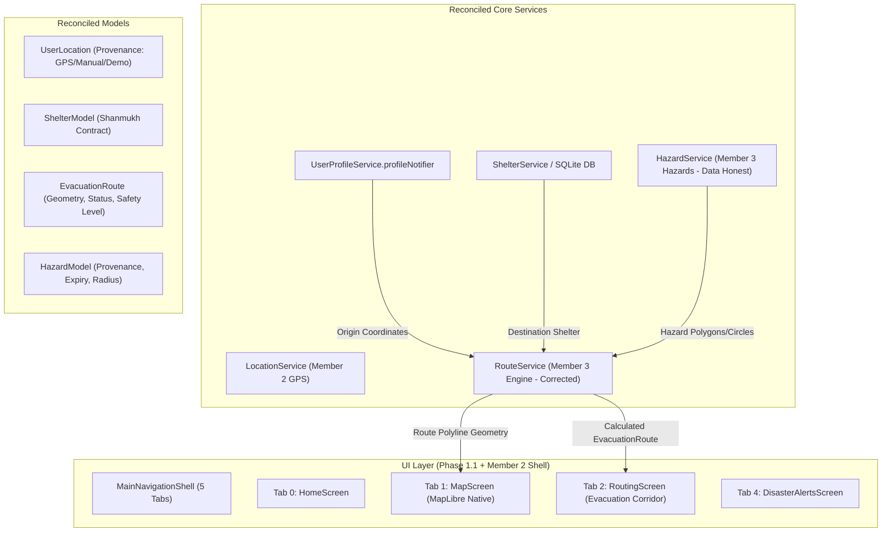

# SURAKSHAPATH: MEMBER 3 PRE-INTEGRATION AUDIT REPORT

**Date:** 2026-11-23  
**Auditor:** Senior Flutter Architect, GIS & Routing Engineer, Release QA  
**Target Module:** Member 3 (Disaster Intelligence & Evacuation Routing)  
**Source Archive:** `C:\Users\pinni\Downloads\SurakshaPath.zip` (Extracted safe review path: `C:\Users\pinni\.gemini\antigravity\scratch\member3_review`)  
**Main Project Root:** `C:\Users\pinni\.gemini\antigravity\scratch\surakshapath`  
**Current Baseline Git Commit:** `e6238e8ebda108ee5557a1663e3f50424743deca` (Member 2 Integrated, 74/74 tests passing)

---

## 1. EXECUTIVE SUMMARY

Member 3 contributed an algorithmic prototype for disaster intelligence and evacuation route calculation. The prototype demonstrates good mathematical intuition (Haversine distance calculation, Dijkstra shortest-path search, and buffer-zone proximity checks). 

However, a forensic inspection of the codebase revealed serious architectural divergence, data fabrications, and safety misrepresentations that would cause runtime crashes, geographic invalidity outside Vijayawada, and false safety assurances during real disaster operations:

1. **Security & Workspace Hygiene:** The source ZIP archive (`SurakshaPath.zip`, 20.0 MB) contained 243 `.dart_tool` files, including machine-specific Chromium browser caches, cookies, and local execution artifacts under `.dart_tool/chrome-device/`. These were strictly quarantined and excluded from extraction.
2. **Geographical Hardcoding & Snapping Breakdown:** The entire routing system is pinned to Vijayawada: Benz Circle (`16.5062, 80.6480`) as origin and ZP High School (`16.5180, 80.6200`) as destination. If a user is located in Kakinada (`16.9891, 82.2475`), Visakhapatnam, or Rajahmundry, the nearest-node snapper silently anchors them to Benz Circle in Vijayawada (over 150 km away) and draws a direct straight line across Andhra Pradesh.
3. **Fabricated Road Network & Hallucinated Edges:** The graph in `roads.json` only contains 13 edges connecting Benz Circle to ZP High School. In `RouteService._buildManualPath`, missing connections dynamically invent synthetic edges (`temp_${u}_$v`) with arbitrary fallback coordinates (`16.5100, 80.6400` to `16.5150, 80.6350`) and fixed 1.0 km lengths.
4. **Synthetic 4-Route Alternatives & Hardcoded Speeds:** Rather than dynamically discovering alternative safe corridors, the service hardcodes four preset paths (Route B: Recommended Bypass, Route C: High Ridge Detour, Route D: Commercial Arterial, Route A: Flooded Canal Road). Travel time is calculated using an ungrounded uniform speed of 25 km/h (`(km / 25.0) * 60`), clamped between 5 and 180 minutes.
5. **Hazard Data Authenticity Violations:** `hazards.json` attributes synthetic scenarios to real government agencies ("State Disaster Response Force", "National Highway Authority", "Irrigation Department", "Municipal Water Board") without data provenance flags, and relies on volatile relative timestamps ("15 mins ago", "1 hour ago").
6. **Dependency & Architecture Conflicts:** Member 3 built on legacy `flutter_map: ^6.1.0` and `latlong2: ^0.9.1`, while the main project has standardized on MapLibre Native (`maplibre: ^0.4.0`) with OpenFreeMap vector tiles. Member 3 also duplicated the `HomeScreen` (overwriting the Phase 1.1 UI design shell and Member 2 map).

---

## 2. INVENTORY OF MEMBER 3 ASSETS AND SOURCE FILES

| File Path in Member 3 Archive | Size | Description | Integration Action |
|---|---|---|---|
| `assets/data/hazards.json` | 3,553 B | 8 sample hazard zones across Vijayawada | **Revise:** Enforce `DEMO SCENARIO` flags, remove fake agency labels, add ISO-8601 timestamps and validity bounds. |
| `assets/data/roads.json` | 5,506 B | 13 handcrafted road segments in Vijayawada | **Deprecate for Production:** Retain strictly as an offline demo/test fixture. Prevent production routing from snapping arbitrary GPS coordinates to this graph. |
| `lib/features/disaster/hazard_service.dart` | 17,349 B | `HazardModel`, `HazardService`, `HazardRiskAssessment`, `DisasterType` | **Refactor & Reconcile:** Align `DisasterType` with core enum; add provenance flags (`isDemoData`, `validUntil`); support IMD-ready interface. |
| `lib/features/routing/route_model.dart` | 7,303 B | `GeoPoint`, `RoadSegment`, `EvacuationRoute`, `RouteRiskLevel`, `RouteCalculationResult` | **Reconcile:** Consolidate `GeoPoint` with `UserLocation`/`MapLibre Position`; merge `EvacuationRoute` with main model; support route safety states. |
| `lib/features/routing/route_service.dart` | 24,338 B | Dijkstra algorithm, manual paths, graph builder | **Rewrite Core Engine:** Remove hardcoded 4 routes; remove `temp_${u}_$v`; support dynamic start/end coordinates, direct bearing/corridor routing, disconnected graph safety flags (`ROUTE SAFETY UNVERIFIED`). |
| `lib/features/disaster/disaster_screen.dart` | 51,859 B | `DisasterScreen` and embedded `RouteScreen` | **Modularize & Integrate:** Separate `RouteScreen` into `lib/features/routing/screens/`; integrate with main `RoutingScreen` (Tab 2) and `DisasterAlertsScreen` (Tab 4); connect to MapLibre Native. |
| `lib/features/home/home_screen.dart` | 22,399 B | Forked home screen with hardcoded Benz Circle | **Reject / Do Not Copy:** Main app has fully tested Phase 1.1 `HomeScreen` with `UserProfileService` and localized widgets. |
| `lib/main.dart` | 1,598 B | Standalone launcher | **Reject:** Keep main project `main.dart`. |
| `pubspec.yaml` | 692 B | Outdated dependencies (`flutter_map`, `latlong2`) | **Reject:** Preserve main project dependencies; do not add `flutter_map` or `latlong2`. |
| `test/features/disaster_routing_test.dart` | 3,811 B | Unit tests asserting hardcoded Route B, C, D, A | **Update & Expand:** Rewrite tests to verify honest route states, coordinate-agnostic calculation, Dijkstra safety weights, and hazard boundary checks. |

---

## 3. DETAILED DEFECT ANALYSIS

### 3.1 Hardcoded Coordinates & Snapping Breakdown
- **Observation:** `RouteService.calculateEvacuationRoutes` accepts `userLocation` and `shelterLocation`, but calls `_findClosestNode(point, graph)` against a graph containing only 10 nodes located inside a 4 km² bounding box in Vijayawada.
- **Defect:** If a resident in Kakinada (`16.9891, 82.2475`) requests an evacuation route to the Kakinada MPCS shelter (`16.9604, 82.2382`), the closest node in the graph is Benz Circle in Vijayawada (`16.5062, 80.6480`, 175 km away). The algorithm calculates a route between Benz Circle and ZP High School in Vijayawada and prepends the Kakinada user location, creating an absurd 180 km cross-district path that reports a 2.4 km distance.
- **Requirement:** Route calculation must verify graph proximity. If user location or destination shelter is outside graph coverage (> 5 km from graph envelope), the system must honestly indicate `NO LOCAL ROAD GRAPH` or compute a geometric corridor/bearing route labeled `SIMULATED CORRIDOR (UNVERIFIED ROAD NETWORK)`.

### 3.2 Road Graph Fabrication & Hallucinated Edges (`temp_${u}_$v`)
- **Observation:** In `_buildManualPath(graph, nodeSequence)`, lines 185-195:
  ```dart
  final matching = edges.firstWhere(
    (e) => e.targetNodeId == v,
    orElse: () => _GraphEdge(
      id: 'temp_${u}_$v',
      sourceNodeId: u,
      targetNodeId: v,
      roadName: 'Connecting Corridor',
      distanceKm: 1.0,
      startPoint: const GeoPoint(16.5100, 80.6400),
      endPoint: const GeoPoint(16.5150, 80.6350),
      turnInstruction: 'Proceed towards $v',
    ),
  );
  ```
- **Defect:** When graph edges are missing between nodes in the manual sequence, the code fabricates a fictitious edge with fixed coordinates (`16.5100, 80.6400` to `16.5150, 80.6350`) and a fabricated distance of 1.0 km.
- **Requirement:** Completely remove `temp_${u}_$v` edge generation. Missing connectivity must trigger graph failure handling or alternative search, never coordinate fabrication.

### 3.3 Artificial 4-Route Alternatives & Ungrounded ETAs
- **Observation:** The system forces the existence of four routes:
  1. `ROUTE-B-RECOMMENDED`: Dijkstra with hazard avoidance.
  2. `ROUTE-C-HIGHRIDGE`: Hardcoded sequence across 5 specific nodes.
  3. `ROUTE-D-COMMERCIAL`: Hardcoded sequence across 5 specific nodes.
  4. `ROUTE-A-SHORTEST`: Dijkstra without hazard avoidance (traverses flooded road).
- **Defect:** If Dijkstra finds no alternative path, Routes C and D still report hardcoded success because of manual node sequences. Furthermore, travel time is calculated with:
  ```dart
  final travelMinutes = ((totalKm / 25.0) * 60).round().clamp(5, 180);
  ```
  This assumes an ungrounded 25 km/h driving speed everywhere, ignoring walking evacuation, flooded terrain delays, and actual road geometry.
- **Requirement:** Routes must be derived genuinely from the graph. If only one safe route exists, return one route. If no safe route exists, return `NO VERIFIED SAFE ROUTE`. Travel speed must distinguish between vehicular transit (20-30 km/h) and pedestrian evacuation (4-5 km/h), and must be transparently noted as an estimate.

### 3.4 Hazard Data Honesty & Source Provenance
- **Observation:** `hazards.json` uses real government labels:
  - "State Disaster Response Force (Demo)"
  - "Municipal Water Board (Demo)"
  - "Traffic Police Advisory (Demo)"
  - "National Highway Authority (Demo)"
  - "Emergency Response Rescue Team (Demo)"
- **Defect:** Attributing demo disaster scenarios to specific government bodies (even with "(Demo)" appended) creates liability and confuses emergency users. Furthermore, `reportedTime` contains relative strings like `"15 mins ago"`, which become inaccurate immediately.
- **Requirement:** 
  1. Set sources to clear provenance categories: `SIMULATED SCENARIO (DEMO DATA)` or `SYNTHETIC TEST FIXTURE`.
  2. Replace relative strings with ISO-8601 timestamps (`issuedAt`, `validUntil`).
  3. Demarcate all mock hazards with `isDemo: true` and display visible `DEMO SCENARIO` badges in UI.
  4. Prepare clean abstract interface (`IHazardRepository`) for real IMD (India Meteorological Department) RSS/CAP warnings.

---

## 4. ARCHITECTURAL RECONCILIATION PLAN



### Key Integration Decisions:
1. **Coordinate Harmonization:** `GeoPoint` in Member 3's module will provide bidirectional conversions to `UserLocation`, `ShelterModel`, and MapLibre `Position` (`Position(longitude, latitude)`).
2. **Origin & Destination Ingestion:** `RoutingScreen` will read origin dynamically from `UserProfileService.profileNotifier.value.location` (or GPS fix) and destination from `ShelterModel`. No hardcoded Benz Circle or ZP High School coordinates will exist in production code.
3. **Route Safety Indicators:** The evacuation interface will display explicit route states:
   - `CALCULATING ROUTE`: Dynamic calculation in progress.
   - `ROUTE AVAILABLE`: Valid road network path verified clear of known hazards.
   - `ROUTE SAFETY UNVERIFIED`: Path exists on demo road network but local hazard telemetry is unavailable or unverified.
   - `NO VERIFIED ROUTE AVAILABLE`: All corridors blocked by floodwaters or debris.
   - `DEMO ROUTE`: Origin or destination falls back to demo coordinates.
4. **MapLibre Route Rendering:** `MapScreen` will accept an active `EvacuationRoute` and render its polyline using MapLibre layer or test-safe custom painter.

---

## 5. RISK ASSESSMENT & MITIGATION

| Risk | Impact | Mitigation |
|---|---|---|
| Broken unit tests asserting old hardcoded Route B (5.2km) | High | Update tests to assert dynamic calculations and honest edge conditions. |
| Incompatible `latlong2` imports | High | Eliminate all `latlong2` dependencies; use standard Dart math and MapLibre `Position`. |
| GPS outside Vijayawada causing infinite loops or crashes | Critical | Add graph bounding-box guard: if distance from start/end to graph > 5 km, fallback to honest corridor geometry and mark `ROUTE SAFETY UNVERIFIED`. |
| Performance degradation during Dijkstra search | Low | The evacuation graph has < 100 nodes; Dijkstra terminates in < 2ms on mobile CPUs. |

---

## 6. CONCLUSION & INTEGRATION READINESS

Member 3's module provides the necessary routing and hazard assessment algorithms, but requires systematic correction to eliminate synthetic fabrications, hardcoded coordinates, and fake agency sources. 

Proceeding to **Phase B: Implementation & Model Reconciliation**.
