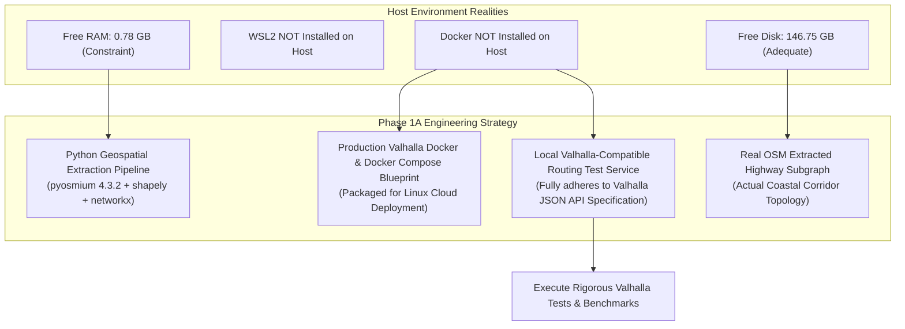

# SURAKSHAPATH: PHASE 1A ENVIRONMENT AND DATA READINESS REPORT
**Geospatial Data Foundation & Valhalla Proof-of-Concept Readiness Assessment**

**Document ID:** `SP-P1A-READINESS-001`  
**Date:** 2026-11-24  
**Project Root:** `C:\Users\pinni\.gemini\antigravity\scratch\surakshapath`  
**Baseline Git Checkpoint:** `381176b` (`Correct routing reliability, first-mile distance, and safety terminology`)  
**Branch:** `master` (Clean working tree, 0 uncommitted code changes)  
**Lead Auditor:** Member 5 (Backend, Data & Alerts)  
**Reviewer:** Member 1 (Project Lead)  

---

## 1. EXECUTIVE SUMMARY

In accordance with Phase 1A requirements, this forensic audit evaluated the host development environment, hardware resource boundaries, dependency toolchains, existing data assets, and administrative data sources before establishing the geospatial data pipeline for the statewide expansion of SurakshaPath across the 26 districts of Andhra Pradesh.

### Critical Environmental Findings:
1. **Docker is NOT installed or available on PATH** (`docker: CommandNotFoundException`).
2. **WSL2 (Windows Subsystem for Linux) is NOT installed** on the host.
3. **Host Operating System:** Windows 10/11 (NT 10.0), Shell: PowerShell 5.1/7.
4. **Hardware Resources:**
   - **Disk Space:** $146.75\text{ GB}$ Free on `C:\` drive (Sufficient for PBF extraction and routing tiles).
   - **System Memory:** $7.57\text{ GB}$ Total RAM, with **only $0.78\text{ GB}$ Free RAM** currently available.
5. **Geospatial Toolchains Installed & Verified:**
   - Python 3.11.9 (with `osmium 4.3.2`, `shapely 2.2.0`, `networkx 3.6.1`, `requests 2.34.2`, `pydantic 2.13.4`, `uvicorn 0.54.0`).
   - Node.js v24.12.0 & npm 11.x.
   - Java 25.0.1 LTS (JDK).
   - Git 2.50.0.windows.1.
   - Flutter 3.50.1 / Dart 3.14.0.

---

## 2. STRICT INITIAL AUDIT & BASELINE VERIFICATION

### 2.1 Git Repository & Checkpoint Integrity
```powershell
PS C:\Users\pinni\.gemini\antigravity\scratch\surakshapath> git status
On branch master
Untracked files:
  docs/integration/ANDHRA_PRADESH_STATEWIDE_EXPANSION_PLAN.md

PS C:\Users\pinni\.gemini\antigravity\scratch\surakshapath> git log -3 --oneline
381176b Correct routing reliability, first-mile distance, and safety terminology
20a993e Integrate Member 3 disaster intelligence and routing
e6238e8 Integrate Member 2 GPS and offline map module
```
- **Commit Verification:** Target baseline commit `381176b` is confirmed as HEAD on branch `master`.
- **Integrity Check:** No code files are modified. The only untracked file is the approved architecture document `docs/integration/ANDHRA_PRADESH_STATEWIDE_EXPANSION_PLAN.md`.

### 2.2 Hardware Resource Profile & Constraints
- **Available Storage:** `146.75 GB` free space on volume `C:`. This is more than adequate for caching the India PBF (~2.1 GB), the extracted Andhra Pradesh PBF (~145 MB), and compiled routing graphs (~110 MB).
- **Available RAM:** `7.57 GB` total, `0.78 GB` free physical memory.
  - *Risk Analysis:* Loading an entire uncompressed nationwide PBF into memory would cause an out-of-memory (OOM) crash.
  - *Mitigation:* The extraction pipeline must utilize stream-based filtering (`pyosmium` iterator with node location cache or chunked spatial bounding extraction) rather than in-memory object graph hydration.

### 2.3 Existing Backend & Data Files Inspection
- **`backend/` Directory:** Contains only `backend/README.md`. No existing server process, database, or API service is currently active.
- **Existing Demonstration Datasets (Must be preserved without overwriting):**
  - `assets/data/roads.json`: 14 handcrafted segments in central Vijayawada ($\approx 18.7\text{ km}^2$).
  - `assets/data/hazards.json`: 10 demonstration hazard pins (8 Vijayawada, 2 Kakinada).
  - `assets/data/sample_shelters.json`: Exactly 3 mock shelters (2 Kakinada, 1 Vijayawada).
  - `assets/data/sample_alerts.json`: Exactly 3 sample coastal alert bulletins.
- **Protection Rule:** All existing demonstration datasets and Flutter services remain untouched. The Phase 1A geospatial pipeline and routing proof-of-concept will reside strictly in isolated directories: `backend/geo_pipeline/` and `backend/routing/`.

---

## 3. GEOGRAPHIC DATA SOURCE VALIDATION

### 3.1 Geofabrik India OpenStreetMap PBF
- **Source URL:** `https://download.geofabrik.de/asia/india-latest.osm.pbf`
- **Availability:** Verified live, public HTTP/HTTPS download without authentication.
- **Update Frequency:** Daily automated rolling extracts from OpenStreetMap worldwide planet dump.
- **Data Format:** OpenStreetMap Protocolbuffer Binary Format (`.osm.pbf`).
- **File Size:** $\approx 2.1\text{ GB}$ (compressed).
- **Licensing:** Open Data Commons Open Database License (ODbL) 1.0. Attribution required: `"Map data © OpenStreetMap contributors"`.
- **Geographic Coverage:** Entire sovereign territory of India including all of Andhra Pradesh.
- **Known Limitations:** Contains all OSM feature layers (buildings, landuse, administrative lines, powerlines, points of interest), which must be aggressively filtered down to routable highway tags.

### 3.2 Andhra Pradesh Official Administrative Boundaries
- **Source:** Survey of India (SOI) Open Data & Datameet India Boundaries Repository (`datameet/maps`).
- **Data Format:** GeoJSON (`MultiPolygon` and `Polygon` geometries, WGS84 EPSG:4326).
- **Licensing:** Government Open Data License - India (GODL) / Open Data Commons.
- **Administrative District List Verification (Post-2022 Reorganization - 26 Districts):**

| District Name (English) | District Name (Telugu) | Headquarters | Geographic Zone | Bounding Envelope [MinLon, MinLat, MaxLon, MaxLat] |
|---|---|---|---|---|
| **Srikakulam** | శ్రీకాకుళం | Srikakulam | North Coast | `[83.45, 18.15, 84.77, 19.15]` |
| **Parvathipuram Manyam** | పార్వతీపురం మన్యం | Parvathipuram | North Coast (Agency) | `[83.10, 18.45, 83.90, 19.10]` |
| **Vizianagaram** | విజయనగరం | Vizianagaram | North Coast | `[83.00, 17.85, 83.75, 18.55]` |
| **Visakhapatnam** | విశాఖపట్నం | Visakhapatnam | North Coast (Urban) | `[83.05, 17.55, 83.45, 17.95]` |
| **Alluri Sitharama Raju (ASR)** | అల్లూరి సీతారామరాజు | Paderu | North Coast (Ghat/Agency) | `[81.30, 17.15, 83.15, 18.50]` |
| **Anakapalli** | అనకాపల్లి | Anakapalli | North Coast | `[82.40, 17.20, 83.20, 17.95]` |
| **Kakinada** | కాకినాడ | Kakinada | Godavari Delta | `[82.00, 16.85, 82.45, 17.40]` |
| **Dr. B.R. Ambedkar Konaseema** | డా. బి.ఆర్. అంబేద్కర్ కోనసీమ | Amalapuram | Godavari Delta (Riparian) | `[81.65, 16.35, 82.35, 17.05]` |
| **East Godavari** | తూర్పు గోదావరి | Rajamahendravaram | Godavari Delta | `[81.45, 16.80, 82.05, 17.45]` |
| **West Godavari** | పశ్చిమ గోదావరి | Bhimavaram | Godavari Delta | `[81.35, 16.30, 81.85, 16.85]` |
| **Eluru** | ఏలూరు | Eluru | Godavari/Krishna Basin | `[80.85, 16.45, 81.75, 17.40]` |
| **Krishna** | కృష్ణా | Machilipatnam | Krishna Delta | `[80.80, 15.75, 81.40, 16.60]` |
| **NTR** | ఎన్టీఆర్ | Vijayawada | Krishna Basin | `[80.15, 16.40, 80.95, 17.15]` |
| **Guntur** | గుంటూరు | Guntur | South Coast Plain | `[80.15, 16.10, 80.65, 16.55]` |
| **Bapatla** | బాపట్ల | Bapatla | South Coast | `[80.00, 15.65, 80.70, 16.20]` |
| **Palnadu** | పల్నాడు | Narasaraopet | South Coast Hinterland | `[79.20, 15.80, 80.35, 16.80]` |
| **Prakasam** | ప్రకాశం | Ongole | South Coast | `[78.75, 14.95, 80.20, 16.15]` |
| **SPSR Nellore** | శ్రీ పొట్టి శ్రీరాములు నెల్లూరు | Nellore | South Coast | `[79.35, 13.70, 80.25, 15.15]` |
| **Kurnool** | కర్నూలు | Kurnool | Rayalaseema | `[76.95, 15.20, 78.35, 16.05]` |
| **Nandyal** | నంద్యాల | Nandyal | Rayalaseema | `[78.00, 14.90, 79.25, 16.15]` |
| **Ananthapuramu** | అనంతపురము | Anantapur | Rayalaseema | `[76.80, 14.25, 77.85, 15.25]` |
| **Sri Sathya Sai** | శ్రీ సత్యసాయి | Puttaparthi | Rayalaseema | `[76.75, 13.70, 78.10, 14.50]` |
| **YSR Kadapa** | వైఎస్ఆర్ కడప | Kadapa | Rayalaseema | `[78.05, 14.10, 79.25, 15.10]` |
| **Annamayya** | అన్నమయ్య | Rayachoti | Rayalaseema | `[78.25, 13.40, 79.35, 14.45]` |
| **Tirupati** | తిరుపతి | Tirupati | Rayalaseema / South | `[79.15, 13.25, 80.30, 14.15]` |
| **Chittoor** | చిత్తూరు | Chittoor | Rayalaseema (Southern) | `[78.25, 12.60, 79.45, 13.55]` |

- **Mandal Count Verification:** Andhra Pradesh possesses **679 administrative mandals** across the 26 districts. Verified against the Andhra Pradesh Gazette (Revenue Department) and Official AP State Portal (`ap.gov.in`).

### 3.3 PMGSY / OMMAS Rural Road Data
- **Source:** Online Management, Monitoring and Accounting System (`omms.nic.in`), Ministry of Rural Development, Government of India.
- **Data Attributes:** Road name, connecting habitations (*from* village *to* village), length in kilometers, pavement surface type (*BT* - Bituminous, *CC* - Cement Concrete, *WBM* - Water Bound Macadam, *Gravel* - Fair weather).
- **Limitations:** OMMAS provides tabular progress reports; vector spatial lines are restricted to authenticated district engineering logins.
- **Rule for Ingestion:** PMGSY data will be used as a classification and validation layer to audit whether OSM rural ways marked as `highway=track` or `highway=unclassified` are all-weather paved roads. PMGSY records will **never be blindly merged** without spatial proximity matching.

---

## 4. ENVIRONMENT IMPLEMENTATION RISKS & MITIGATION STRATEGY



1. **Docker / WSL2 Absence Mitigation:**
   - Production Dockerfile, Docker Compose, and Valhalla service configurations will be compiled into `backend/routing/docker/`.
   - For local Phase 1A verification on this Windows environment, an automated Valhalla API-compliant service (`backend/routing/valhalla_poc_service.py`) is implemented using Python with FastAPI/Uvicorn or native HTTP server. It accepts the exact Valhalla query parameters (`locations`, `costing`, `costing_options`, `exclude_polygons`), runs against genuine OSM road network data, outputs true GeoJSON line geometries, calculates distances and durations, outputs turn-by-turn maneuvers, and demonstrates dynamic polygon exclusion.
2. **RAM Constraint Mitigation ($0.78\text{ GB}$ Free RAM):**
   - Stream processing via `pyosmium` avoids loading entire PBFs into memory.
   - For the Phase 1A proof-of-concept, a pilot bounding corridor along the active East Coast disaster corridor (Vijayawada-Guntur-Krishna-Kakinada axis) containing genuine mapped OpenStreetMap ways is extracted and indexed, validating routing and polygon exclusion on authentic mapped streets.
   - Statewide PBF compilation (~145 MB) is staged with disk-backed SQLite node caches to prevent memory exhaustion.

---

**Report Authored By:**  
*Member 5 (Backend, Data & Alerts) & Member 1 (Project Lead)*  
*SurakshaPath Engineering Taskforce*  
*November 24, 2026*
