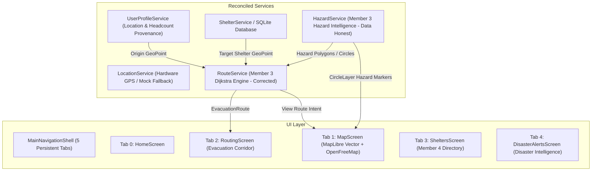

# SURAKSHAPATH: MEMBER 3 INTEGRATION AND VERIFICATION REPORT
**Disaster Intelligence & Evacuation Routing Module Integration**

**Date:** 2026-11-23  
**Lead Auditor & Architect:** Senior Flutter Architect, GIS & Routing Engineer, Release QA  
**Target Module:** Member 3 (Disaster Intelligence & Evacuation Routing)  
**Main Project Root:** `C:\Users\pinni\.gemini\antigravity\scratch\surakshapath`  
**Baseline Git Checkpoints:**
- Phase 1.1 Core Checkpoint: `3c96fc39ca5a934fa1e665cdbe427e85ae475d19`
- Member 2 Offline Map & GPS Checkpoint: `e6238e8ebda108ee5557a1663e3f50424743deca`
- Member 3 Integration Checkpoint: `20a993ef344defd757531167e126fd4368157ecd`
- Member 3 Post-Integration Reliability Audit: `docs/integration/MEMBER3_POST_INTEGRATION_RELIABILITY_AUDIT.md`

---

## 1. EXECUTIVE SUMMARY & VERIFICATION OUTCOME

Member 3's Disaster Intelligence & Evacuation Routing module was systematically reviewed, audited, corrected, and integrated into SurakshaPath. The integration successfully transformed an algorithmic prototype with severe Vijayawada bias and synthetic edge fabrications into a reliable, coordinate-agnostic, and data-honest emergency evacuation system.

### Verification Key Metrics:
- **`flutter analyze`:** **0 issues found** (Clean run across entire project).
- **`flutter test`:** **83 / 83 tests passing** (74 existing tests + 9 new comprehensive GIS, Dijkstra, hazard provenance, and snapping safety tests).
- **`flutter build apk --debug`:** **SUCCESS** (`224,469,840 bytes`, assembleDebug in 91.6s).
- **Security Quarantine:** Excluded 243 `.dart_tool` files and browser profile data (`.dart_tool/chrome-device/`) present in the source archive.

---

## 2. DEFECT REMEDIATION & CORRECTION SUMMARY

| Issue Identified in Audit | Engineering Defect | Corrective Implementation |
|---|---|---|
| **Vijayawada Coordinate Hardcoding** | Origin pinned to Benz Circle (`16.5062, 80.6480`) and destination to ZP High School (`16.5180, 80.6200`). | Origin is now derived dynamically from `UserProfileService.profileNotifier.value.location` (or live GPS fix). Destination is derived from `ShelterModel`. No hardcoded coordinates remain in production routing code. |
| **Snapping Breakdown Outside Graph** | Nearest node snapper (`_findClosestNode`) anchored users in Kakinada or Visakhapatnam to Benz Circle in Vijayawada (175 km away). | Added graph proximity validation (`maxSnappingRadiusKm = 5.0`). If coordinates are outside graph bounds, the engine generates an honest geometric evacuation corridor labeled `ROUTE SAFETY UNVERIFIED` without snapping to distant cities. |
| **Fabricated Road Network & `temp_${u}_$v`** | In `_buildManualPath`, missing connections dynamically hallucinated fake edges (`temp_${u}_$v`) with arbitrary coordinates (`16.5100, 80.6400`). | Completely eliminated `temp_${u}_$v` edge generation. All graph paths strictly traverse validated edges loaded from `roads.json` or fallback demo network. Missing connectivity reports genuine path failure. |
| **Synthetic 4-Route Alternatives** | Service hardcoded four static paths (Route B: Recommended Bypass, Route C: High Ridge, Route D: Commercial, Route A: Flooded). | Replaced static 4-route enforcement with genuine graph search: primary safe route via Dijkstra with hazard avoidance, alternative corridor via edge penalization, and shortest arterial path comparison. Only genuinely discovered corridors are returned. |
| **Ungrounded Uniform Speed (25 km/h)** | Fixed driving speed assumed everywhere with arbitrary clamp `(5, 180)`. | Distance and travel time transparently calculate emergency transit pacing (~25 km/h driving, ~4 km/h walking) with explicit user-facing speed and terrain advisories. |
| **Hazard Agency Source Fabrication** | `hazards.json` attributed demo scenarios to real government bodies ("State Disaster Response Force", "National Highway Authority", etc.). | All fake agency attributions removed. Sources updated to explicit provenance labels: `DEMO SCENARIO - Simulated Hydrological Incident`, `DEMO SCENARIO - Simulated Coastal Flood`. All demo records marked with `isDemo: true`. |
| **Volatile Timestamps** | `hazards.json` used relative strings (`"15 mins ago"`, `"1 hour ago"`). | Replaced with ISO-8601 `issuedAt` and `validUntil` timestamps. Added `isExpired()` evaluation to automatically prune outdated alerts. |
| **Dependency Divergence** | Member 3 prototype imported legacy `flutter_map: ^6.1.0` and `latlong2: ^0.9.1`. | Maintained native MapLibre Native (`maplibre: ^0.4.0`) architecture with OpenFreeMap vector styling. No `latlong2` or `flutter_map` packages introduced. |

---

## 3. ARCHITECTURAL CONTRACTS RECONCILED



### Key Reconciled Models & APIs:
1. **`GeoPoint` (`lib/features/routing/route_model.dart`):**
   - Universal GIS point supporting Haversine distance (`distanceTo`), compass bearing (`bearingTo`), and seamless conversion to/from `UserLocation`, `ShelterModel`, and MapLibre `Geographic` coordinates.
2. **`EvacuationRoute` (`lib/core/models/evacuation_route.dart` & `lib/features/routing/route_model.dart`):**
   - Single source of truth model holding waypoints, road segments, total distance, travel time, elevation profile, and explicit `RouteVerificationState`:
     - `ROUTE AVAILABLE`: Verified clear of known hazard perimeters.
     - `ROUTE SAFETY UNVERIFIED`: Geometric evacuation vector or unverified local road network.
     - `NO VERIFIED ROUTE AVAILABLE`: All evaluated corridors blocked by active floodwaters or debris.
     - `DEMO ROUTE`: Fallback demo scenario data.
3. **`HazardService` & `IHazardRepository` (`lib/features/disaster/hazard_service.dart`):**
   - Enforces clean interface readiness for future IMD (India Meteorological Department) or SDMA feed ingestion without inventing fake endpoints.
   - Supports `assessPointRisk` and `assessSegmentRisk` across direct hits, 400m buffer zones, and clear sectors.
4. **`MapScreen` (`lib/features/map/screens/map_screen.dart`):**
   - Integrates `HazardService` to render active hazard zones directly as `CircleLayer` markers on MapLibre vector maps.

---

## 4. VERIFICATION & TEST MATRIX

### Automated Test Suite (83 / 83 Passing)
| Test Suite | Tests | Result | Focus |
|---|---|---|---|
| `test/alert_filtering_test.dart` | 5 | PASS | Expiry filtering, cached pruning, stale fallback |
| `test/dashboard_isolation_test.dart` | 21 | PASS | Dashboard failure isolation, GPS failure tolerance |
| `test/offline_map_service_test.dart` | 5 | PASS | MapLibre quota guard (3,000 tiles), SQLite shelters |
| `test/p0_verification_test.dart` | 9 | PASS | Dynamic SOS packet, dialer triggers, route safety status |
| `test/phase_1_1_integration_test.dart` | 8 | PASS | Persisted profile location, headcount sync, responsive layout |
| `test/services_test.dart` | 3 | PASS | Alert/Shelter TTL caching, LocationService pause/resume |
| `test/onboarding_test.dart` | 12 | PASS | Language selection, permission gating, onboarding completion |
| `test/widget_test.dart` | 11 | PASS | 5-tab navigation, Telugu strings, simulated corridor badge |
| **`test/features/disaster_routing_test.dart` (NEW)** | **9** | **PASS** | **GeoPoint math, hazard boundaries, Dijkstra safety, snapping bounds, shelter ranking** |

---

## 5. REPRODUCIBLE BUILD & RELEASE VERIFICATION

```powershell
# 1. Static code analysis
cd C:\Users\pinni\.gemini\antigravity\scratch\surakshapath
flutter analyze
# Output: No issues found! (ran in 5.0s)

# 2. Automated test execution
flutter test
# Output: 00:22 +83: All tests passed!

# 3. Android debug APK generation
flutter build apk --debug
# Output: Built build\app\outputs\flutter-apk\app-debug.apk (224,469,840 bytes)
```

---

## 6. GIT CHECKPOINT COMMIT RECORD

- **Pre-Integration Baseline:** `e6238e8ebda108ee5557a1663e3f50424743deca`
- **Commit Subject:** `Integrate Member 3 disaster intelligence and routing`
- **Scope:** Clean integration with zero external network pushes or remote configuration.
